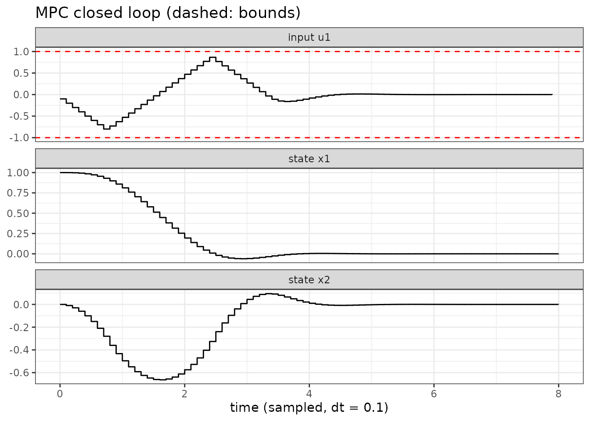
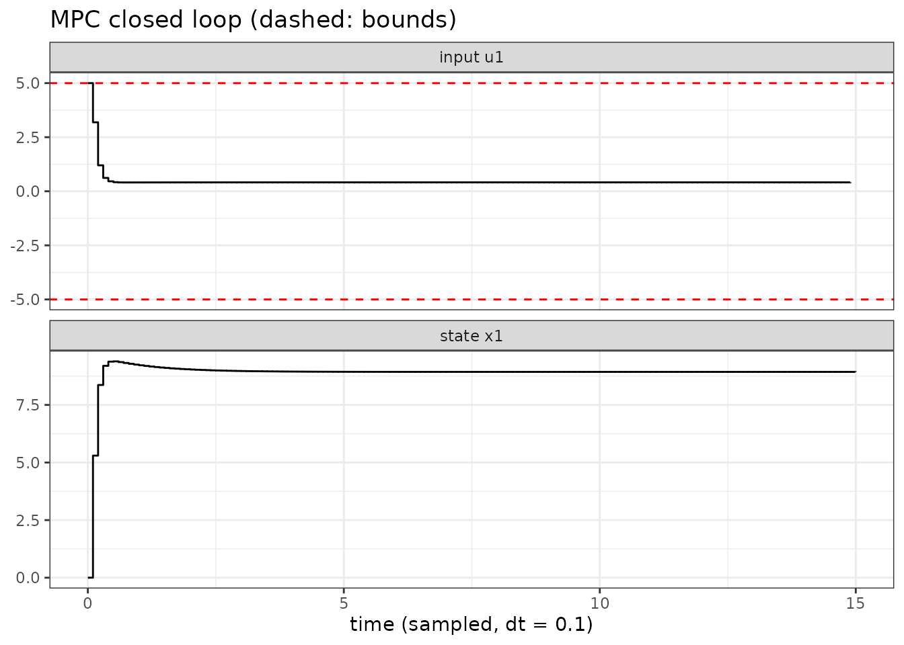
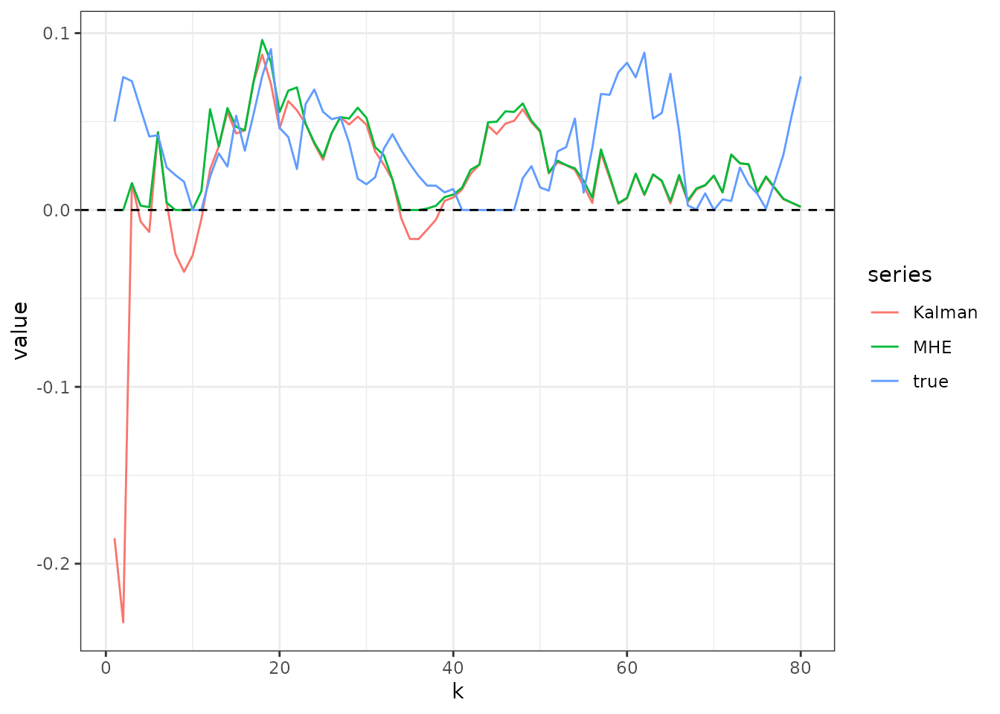

# Advanced MPC and moving horizon estimation

``` r

library(controlcompR)
```

## Input rate limits and move suppression

Actuators often limit how fast the input can change. Rate bounds act on
\Delta u_k = u_k - u\_{k-1}, including the first move relative to the
input applied at the previous sample; the weight `Rd` penalizes moves:

``` r

plant <- ctrl_c2d(ctrl_ss(matrix(c(0, 1, 0, 0), 2, byrow = TRUE), c(0, 1),
                          c(1, 0)), 0.1)
mpc <- ctrl_mpc(plant, horizon = 25, Q = diag(c(10, 1)), R = 0.01, Rd = 1,
                u_min = -1, u_max = 1, du_min = -0.1, du_max = 0.1)
sim <- ctrl_simulate_mpc(mpc, x0 = c(1, 0), steps = 80)
max(abs(diff(c(0, sim$u[, 1]))))
#> [1] 0.1
plot(sim)
```



## Soft constraints

Soft state and output bounds add slack variables s \ge 0, x\_{\min} - s
\le x \le x\_{\max} + s, with cost \rho_q s^2 + \rho_l s. With a large
linear weight the penalty is exact: the slacks are zero whenever the
hard problem is feasible. Input and rate bounds remain hard, because
actuators cannot exceed them.

``` r

soft <- ctrl_mpc(plant, horizon = 5, Q = diag(2), R = 1, u_min = -0.1,
                 u_max = 0.1, x_min = c(-Inf, -0.05), x_max = c(Inf, 0.05),
                 soft = "states", soft_weight = c(1e3, 1e4))
st <- ctrl_mpc_step(soft, c(0, 1))
st$ok
#> [1] TRUE
max(st$slack)
#> [1] 0.94
sim_s <- ctrl_simulate_mpc(soft, c(0, 1), steps = 60)
summary(sim_s)
#> MPC simulation: 60 samples, 0 failed solves (0%)
#>   solver statuses: solved = 60
#>   solve time: mean 5.83e-05 s, max 7.33e-05 s; mean iterations 74.17
#>   max input bound violation: 0
#>   max state bound violation (true plant): 0.94
#>   max slack: 0.94
```

## Offset-free tracking

With model mismatch or an unmeasured constant disturbance, MPC on a
nominal model leaves a steady-state error. The standard remedy augments
the model with a disturbance d\_{k+1} = d_k, estimates it with a Kalman
filter, computes the steady-state target (x_s, u_s) that cancels it, and
tracks the target. With an observable augmented model and as many
disturbances as measured outputs, the closed loop has zero offset for
constant references and disturbances whenever it converges.

``` r

model <- ctrl_c2d(ctrl_tf(1, c(1, 1)), 0.1)
truth <- ctrl_c2d(ctrl_tf(1.4, c(1.2, 1)), 0.1)   # gain and time constant wrong
mpc_o <- ctrl_mpc(model, 10, Q = 0, Qy = 1, R = 0.01, u_min = -5, u_max = 5)
est <- ctrl_mpc_estimator(mpc_o, "output", Qn = 1e-4, Qd = 1e-3, Rn = 1e-4)

plain <- ctrl_simulate_mpc(mpc_o, x0 = 0, steps = 150, plant = truth,
                           reference = list(y = 1, x = 1, u = 1),
                           disturbance = 0.3)
offset_free <- ctrl_simulate_mpc(mpc_o, x0 = 0, steps = 150, plant = truth,
                                 reference = list(y = 1), estimator = est,
                                 disturbance = 0.3)
c(plain = plain$y[150, 1], offset_free = offset_free$y[150, 1])
#>       plain.y1 offset_free.y1 
#>       1.261399       1.000000
plot(offset_free)
```



The plain controller settles at the wrong value; the offset-free design
reaches the setpoint despite the wrong model and the input disturbance.
`type = "input"` models the disturbance at the plant input instead,
which often gives better transients for input disturbances.

## Moving horizon estimation

Moving horizon estimation (MHE) estimates the state by solving, at every
sample, a least-squares problem over a window of the last N
measurements: \min \\x_s - \bar x_s\\^2\_{P_s^{-1}} + \sum\_{j=s}^{T-1}
\\w_j\\^2\_{Q_n^{-1}} + \sum\_{j=s}^{T} \\y_j - C x_j - D
u_j\\^2\_{R_n^{-1}} subject to the model and to bounds on states and
process noise. The first term, the *arrival cost*, summarizes the data
before the window. Here the prior mean is propagated from the previous
MHE estimate and the prior covariance follows the Kalman filter
recursion. With no active constraints MHE then equals the Kalman filter
exactly, which the tests verify.

MHE is not a Kalman filter: when states have physical bounds (a
concentration cannot be negative), the bounds enter the estimate. The
price is one QP per sample, growing with the window length.

``` r

set.seed(5)
sys <- ctrl_ss(0.95, 1, 1, dt = 1)
Tn <- 80
x <- 0.05
xs <- numeric(Tn)
y <- numeric(Tn)
for (k in 1:Tn) {
  xs[k] <- x
  y[k] <- x + rnorm(1, sd = 0.3)
  x <- max(0, 0.95 * x + rnorm(1, sd = 0.02))
}
kf <- ctrl_kalman_filter(sys, y, Qn = 4e-4, Rn = 0.09, x0 = 0, P0 = 1)
mhe <- ctrl_mhe(sys, horizon = 10, Qn = 4e-4, Rn = 0.09, x0 = 0, P0 = 1, x_min = 0)
est <- ctrl_mhe_run(mhe, y)
c(kalman_min = min(kf$filtered), mhe_min = min(est$estimates))
#>    kalman_min       mhe_min 
#> -2.331457e-01 -1.059524e-17
c(kalman_rmse = sqrt(mean((kf$filtered[, 1] - xs)^2)),
  mhe_rmse = sqrt(mean((est$estimates[, 1] - xs)^2)))
#> kalman_rmse    mhe_rmse 
#>  0.05471087  0.03395546
```

Each window’s QP starts from the previous solution shifted by one
sample, primal and dual (`warm_start = TRUE`, the default). The
estimates do not change; only the solver work does:

``` r

cold <- ctrl_mhe_run(mhe, y, warm_start = FALSE)
c(max_difference = max(abs(cold$estimates - est$estimates)),
  iterations_cold = sum(cold$iterations), iterations_warm = sum(est$iterations))
#>  max_difference iterations_cold iterations_warm 
#>               0            6750            6250
```

``` r

df <- data.frame(k = rep(1:Tn, 3),
                 value = c(xs, kf$filtered[, 1], est$estimates[, 1]),
                 series = rep(c("true", "Kalman", "MHE"), each = Tn))
ggplot2::ggplot(df, ggplot2::aes(k, value, color = series)) +
  ggplot2::geom_line() + ggplot2::geom_hline(yintercept = 0, linetype = "dashed") +
  ggplot2::theme_bw()
```


