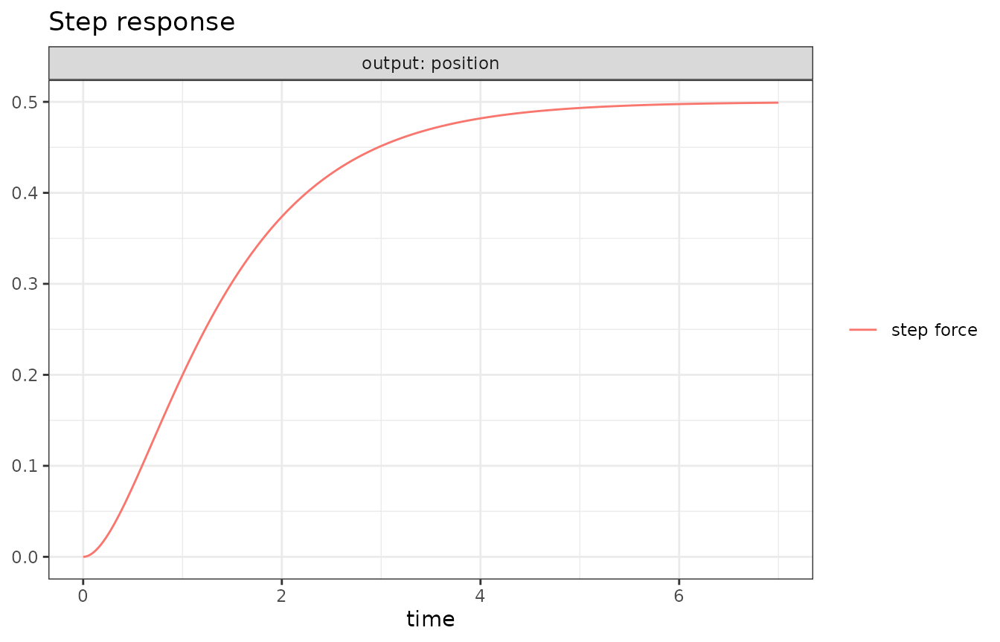
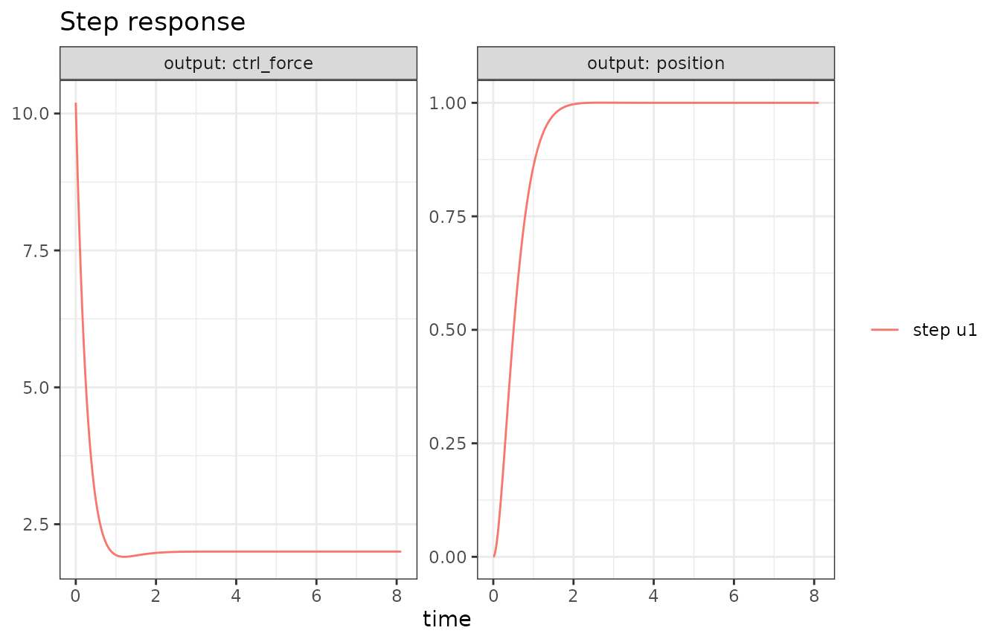
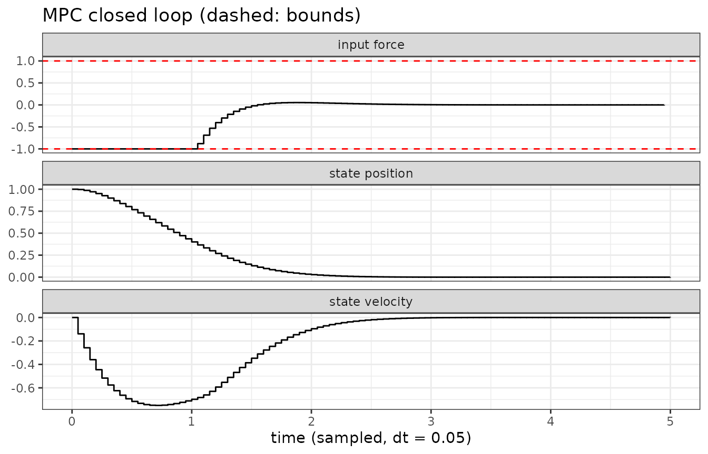
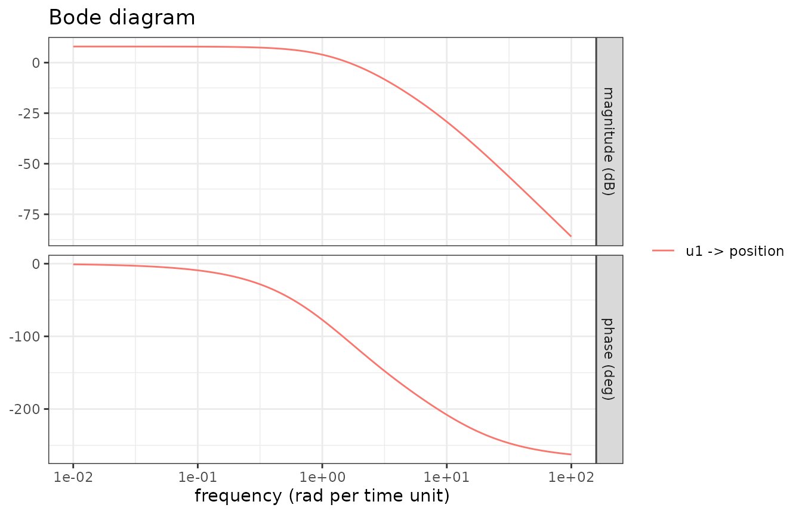

# Getting started with controlcompR

``` r

library(controlcompR)
```

*controlcompR* is a framework for modeling, analyzing, designing and
simulating control systems in R. It covers the path

**model, analysis, design, closed loop, simulation, verification**

for linear state-space and transfer-function models, classical, optimal,
predictive and robust controllers, state estimation, system
identification and nonlinear models. Everything runs in R; the numerical
kernels are LAPACK routines (ordered real and generalized Schur
decompositions, the Bartels-Stewart Sylvester solver) called from
compiled C, and constrained quadratic programs are solved with
[OSQP](https://osqp.org).

This article walks through one complete design. The other articles treat
each topic in depth.

## A first model

A cart of mass 1 on a spring (stiffness 2) with damping 3 has the state
`x = (position, velocity)`:

``` r

plant <- ctrl_ss(
  A = matrix(c(0, 1, -2, -3), 2, byrow = TRUE),
  B = c(0, 1),
  C = c(1, 0),
  state_names = c("position", "velocity"),
  input_names = "force",
  output_names = "position"
)
plant
#> State-space model (continuous time)
#> 2 states, 1 inputs, 1 outputs
#> 
#> A =
#>          position velocity
#> position        0        1
#> velocity       -2       -3
#> 
#> B =
#>          force
#> position     0
#> velocity     1
#> 
#> C =
#>          position velocity
#> position        1        0
#> 
#> D =
#>          force
#> position     0
```

`dt = NULL` (the default) means continuous time. A positive `dt` creates
a discrete time model with that sample interval. The same model as a
transfer function:

``` r

ctrl_ss2tf(plant)
#> Transfer function (continuous time)
#> 
#>               1
#>   ---------------------
#>   s^2 +     3 s +     2
ctrl_poles(plant)
#> [1] -1+0i -2+0i
ctrl_stability(plant)$classification
#> [1] "asymptotically stable"
```

## Responses

``` r

step <- ctrl_step(plant)
plot(step)
```



``` r

ctrl_step_info(plant)
#>     output       case rise_time settling_time overshoot undershoot      peak
#> 1 position step force  2.589619         4.606         0          0 0.4990885
#>   peak_time final_value settled final_value_known
#> 1         7         0.5    TRUE              TRUE
```

The step characteristics have documented definitions (10 to 90 percent
rise time, 2 percent settling band, final value from the DC gain when
the model is stable); see
[`?ctrl_step_info`](https://adamrsophie.github.io/controlcompR/reference/ctrl_step_info.md).

## An optimal state-feedback design

The linear quadratic regulator minimizes \int_0^\infty x^\top Q x +
u^\top R u \\ dt for the law u = -Kx:

``` r

lqr <- ctrl_lqr(plant, Q = diag(c(10, 1)), R = 0.1)
lqr$K
#>       position velocity
#> force 8.198039  2.94946
lqr$poles
#> [1] -2.97473+1.161473i -2.97473-1.161473i
```

[`ctrl_closed_loop()`](https://adamrsophie.github.io/controlcompR/reference/ctrl_closed_loop.md)
forms the closed loop.
[`ctrl_reference_gain()`](https://adamrsophie.github.io/controlcompR/reference/ctrl_reference_gain.md)
computes the static prefilter that gives unit DC gain from the reference
to the output, so the law becomes u = N r - Kx:

``` r

N <- ctrl_reference_gain(plant, lqr)
cl <- ctrl_closed_loop(plant, lqr)
cl_ref <- ctrl_series(ctrl_gain(N), cl)
plot(ctrl_step(cl_ref))
```



The closed-loop model has the plant output and the control signal as
outputs, so the plot shows the actuator effort as well as the tracking
response.

## Discretize and constrain: model predictive control

For digital implementation, discretize with an exact zero-order hold and
design a model predictive controller with an input limit of one unit of
force:

``` r

plant_d <- ctrl_c2d(plant, 0.05)
mpc <- ctrl_mpc(plant_d, horizon = 30, Q = diag(c(10, 1)), R = 0.1,
                P = "lqr", u_min = -1, u_max = 1)
sim <- ctrl_simulate_mpc(mpc, x0 = c(1, 0), steps = 100)
summary(sim)
#> MPC simulation: 100 samples, 0 failed solves (0%)
#>   solver statuses: solved = 100
#>   solve time: mean 0.000108 s, max 0.000228 s; mean iterations 47.5
#>   max input bound violation: 2.22e-16
#>   max state bound violation (true plant): 0
#>   max slack: 0
plot(sim)
```



The summary reports solver statuses, failed solves and the largest bound
violation; a successful solve is not taken for granted. See the articles
on model predictive control for the QP formulation, soft constraints,
offset-free tracking and failure handling.

## Frequency-domain checks

``` r

L <- ctrl_series(ctrl_tf(5, c(0.1, 1)), ctrl_ss2tf(plant))
ctrl_margin(L)
#> Stability margins (unity negative feedback)
#>   gain margin: 7.92 (17.97 dB) at w = 5.657
#>   phase margin: 73.08 deg at w = 1.63
#>   delay margin: 0.7824
#>   nominal closed loop stable: TRUE
plot(ctrl_bode(L))
```



## What controlcompR does and does not claim

- LQR is optimal only for the linear model and quadratic cost it was
  given.
- A successful QP solve does not establish closed-loop stability of MPC.
- LQG controllers have no guaranteed robustness margins.
- A model that predicts the data well is not automatically adequate for
  feedback design.
- H-infinity synthesis is experimental: continuous time, D\_{11} = 0,
  and every controller is certified by an independent norm computation.

The article *Numerical validation and scope* lists the conventions, the
tolerances, the reference comparisons and the capability matrix with the
status of every method.

## Map of the articles

| Article | Topics |
|----|----|
| Models, conversions and interconnections | state space, transfer functions, zpk, c2d, feedback, connect |
| Stability, controllability and matrix equations | poles, staircase, PBH, Lyapunov, Riccati, gramians |
| Time responses | simulation, step, impulse, initial, step metrics |
| Frequency response and robustness margins | Bode, Nyquist, margins, disk margins, norms |
| PID control | filtering, anti-windup, bumpless transfer, tuning |
| State feedback | LQR, pole placement, reference tracking |
| State estimation and LQG | observers, Kalman filters, smoothers, LQG |
| Linear model predictive control | QP formulation, constraints, diagnostics |
| Advanced MPC and moving horizon estimation | rates, soft constraints, offset-free MPC, MHE |
| Robust control | H2, H-infinity, mixed sensitivity, small gain |
| System identification | ARX, subspace, validation, residual tests |
| Nonlinear systems | simulation, linearization, EKF, UKF, NMPC |
| Model reduction | Hankel singular values, balanced truncation |
| Numerical validation and scope | conventions, tests, capability matrix |
