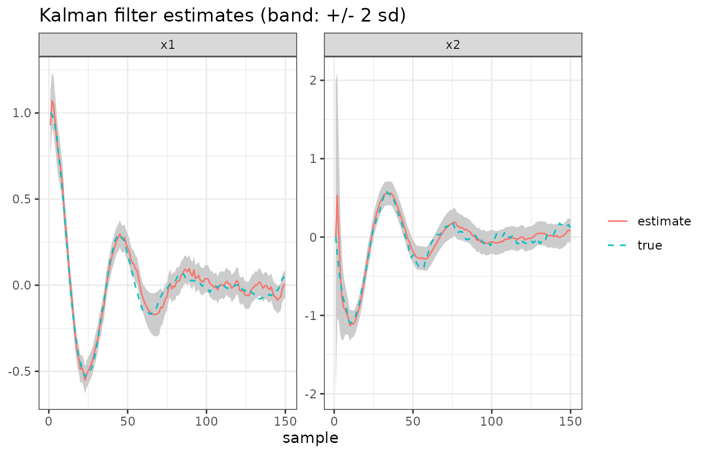

# State estimation and LQG control

``` r

library(controlcompR)
```

## Luenberger observers

When only y = Cx is measured, an observer reconstructs the state:
\dot{\hat x} = A \hat x + B u + L (y - C \hat x - D u). The error e =
x - \hat x obeys \dot e = (A - LC) e, so `L` is a pole placement problem
for the dual pair (A^\top, C^\top):

``` r

plant <- ctrl_ss(matrix(c(0, 1, -2, -0.5), 2, byrow = TRUE), c(0, 1), c(1, 0))
obs <- ctrl_observer(plant, poles = c(-6, -7))
obs
#> Luenberger observer (continuous time)
#> L =
#>       [,1]
#> [1,] 12.50
#> [2,] 33.75
#> attr(,"poles")
#> [1] -7+0i -6+0i
#> attr(,"cond_X")
#> [1] 73.5136
#> attr(,"max_error")
#> [1] 9.414691e-14
#> estimator poles: -7+0i, -6+0i
```

## The steady-state Kalman filter

For x\_{k+1} = A x_k + B u_k + G w_k, y_k = C x_k + D u_k + v_k with
noise covariances Q_n and R_n,
[`ctrl_kalman()`](https://adamrsophie.github.io/controlcompR/reference/ctrl_kalman.md)
returns the steady-state gains. The conventions are stated precisely
because packages differ:

- `P` is the prior (predicted) covariance P\_{k\|k-1};
- `M` is the measurement update gain, \hat x\_{k\|k} = \hat
  x\_{k\|k-1} + M (y_k - C \hat x\_{k\|k-1} - D u_k);
- `L` is the one-step predictor gain (L = AM without cross covariance);
- `Z` is the posterior covariance P\_{k\|k}.

``` r

pd <- ctrl_c2d(plant, 0.1)
kf <- ctrl_kalman(pd, Qn = diag(c(1e-4, 1e-3)), Rn = 0.01)
kf$M
#>            [,1]
#> [1,] 0.15613190
#> [2,] 0.08539392
kf$poles
#> [1] 0.8844266+0.1431844i 0.8844266-0.1431844i
```

`Rn` must be positive definite. Noise-free measurements make the
filtering problem singular, and the package refuses it rather than
adding an invisible regularization.

## The time-varying filter and smoother

[`ctrl_kalman_filter()`](https://adamrsophie.github.io/controlcompR/reference/ctrl_kalman_filter.md)
processes data with the Joseph-form covariance update, which stays
symmetric positive semidefinite in floating point. It returns
innovations, their covariances, the normalized innovation squared (NIS)
and the Gaussian log-likelihood; missing samples (`NA`) skip the update:

``` r

set.seed(1)
Tn <- 150
x <- c(1, 0)
X <- matrix(0, Tn, 2)
y <- numeric(Tn)
for (k in 1:Tn) {
  X[k, ] <- x
  y[k] <- x[1] + rnorm(1, sd = 0.1)
  x <- drop(pd$A %*% x) + rnorm(2, sd = c(0.01, 0.03))
}
y[60:70] <- NA
run <- ctrl_kalman_filter(pd, y, Qn = diag(c(1e-4, 1e-3)), Rn = 0.01,
                          x0 = c(0, 0), P0 = diag(2))
run
#> Kalman filter run over 150 samples, 2 states
#>   log-likelihood: 103.339
#>   mean NIS: 1.038 (expected 1 for a consistent filter)
plot(run, truth = X)
```



A consistent filter has a mean NIS close to the number of outputs; much
larger values point to underestimated noise or a wrong model. The
Rauch-Tung-Striebel smoother uses all the data for every estimate:

``` r

sm <- ctrl_kalman_smoother(run)
c(filter = sqrt(mean((run$filtered[, 1] - X[, 1])^2)),
  smoother = sqrt(mean((sm$smoothed[, 1] - X[, 1])^2)))
#>     filter   smoother 
#> 0.04322331 0.03344030
```

The smoother needs the covariance history of the whole run. For long or
streaming data, `lag` gives fixed-lag smoothed estimates instead: row
`k` uses the measurements up to sample `k + lag`, and only the last
`lag + 1` smoother gains are kept, so it works with
`covariances = "final"`, which stores no per-sample covariance
information at all. Data can also be filtered in chunks by passing
`next_prediction` and `next_covariance` on as the prior of the next
chunk:

``` r

fl <- ctrl_kalman_filter(pd, y, Qn = diag(c(1e-4, 1e-3)), Rn = 0.01,
                         x0 = c(0, 0), P0 = diag(2), lag = 10,
                         covariances = "final")
c(lag_10 = sqrt(mean((fl$lagged[, 1] - X[, 1])^2)))
#>   lag_10 
#> 0.034252
first <- ctrl_kalman_filter(pd, y[1:75], Qn = diag(c(1e-4, 1e-3)), Rn = 0.01,
                            x0 = c(0, 0), P0 = diag(2))
second <- ctrl_kalman_filter(pd, y[76:Tn], Qn = diag(c(1e-4, 1e-3)), Rn = 0.01,
                             x0 = first$next_prediction, P0 = first$next_covariance)
max(abs(rbind(first$filtered, second$filtered) - run$filtered))
#> [1] 0
```

Covariances are inverted only on their support, and that support is
decided after scaling the covariance to unit diagonal. A small but
positive variance therefore stays informative whatever the units of the
other states. Here the first state has prior variance 1e14 and is never
measured; the second is constant with prior variance 1 and one
measurement of variance 0.01, so its smoothed mean is exactly 1/1.01:

``` r

Gs <- ctrl_ss(diag(2), matrix(0, 2, 1), matrix(c(0, 1), 1), dt = 1)
f2 <- ctrl_kalman_filter(Gs, c(NA, 1), Qn = matrix(0, 2, 2), Rn = 0.01,
                         P0 = diag(c(1e14, 1)))
ctrl_kalman_smoother(f2)$smoothed[, 2] - 1 / 1.01
#> [1] 2.220446e-16 2.220446e-16
```

Prior means, measurements and noise covariances must be finite; `NA`
rows in `y` mark missing samples.

## LQG control

An LQG controller combines LQR with a Kalman filter. By the separation
principle the closed-loop poles are the union of the regulator and
estimator poles:

``` r

lqg <- ctrl_lqg(pd, Q = diag(c(1, 0.1)), R = 0.1, Qn = diag(c(1e-4, 1e-3)),
                Rn = 0.01, form = "current")
lqg
#> LQG controller (discrete time, dt = 0.1, current form)
#> regulator poles: 0.8856+0.1429i, 0.8856-0.1429i
#> estimator poles: 0.8844+0.1432i, 0.8844-0.1432i
cl <- ctrl_closed_loop(pd, lqg)
sort(Mod(ctrl_poles(cl)))
#> [1] 0.8959421 0.8959421 0.8970555 0.8970555
sort(Mod(c(lqg$lqr$poles, lqg$kalman$poles)))
#> [1] 0.8959421 0.8959421 0.8970555 0.8970555
```

In discrete time the `"current"` form uses \hat x\_{k\|k}, reacting to
the newest measurement; the `"delayed"` form uses the predictor \hat
x\_{k\|k-1}, leaving a full sample for computation.

### Stochastic simulation over many realizations

A stochastic design should be judged over many noise realizations, not
one favorable trajectory:

``` r

sim <- ctrl_simulate_lqg(pd, lqg, steps = 200, x0 = c(1, 0),
                         replications = 20, seed = 3)
summary(sim$summary[, -1])
#>  rms_estimation_error  average_cost    
#>  Min.   :0.1267       Min.   :0.04288  
#>  1st Qu.:0.1366       1st Qu.:0.04660  
#>  Median :0.1408       Median :0.04875  
#>  Mean   :0.1407       Mean   :0.04857  
#>  3rd Qu.:0.1457       3rd Qu.:0.05078  
#>  Max.   :0.1493       Max.   :0.05293
```

### No guaranteed margins

LQR with full state feedback has at least 60 degrees of phase margin,
but an LQG controller has no guaranteed margins at all (Doyle, 1978).
Always check the margins of the actual loop. The controller maps `y` to
`u` including the minus sign, so the loop transfer function for the
unity negative feedback convention is L = -K_c G:

``` r

Lloop <- ctrl_series(-lqg$controller, pd)
ctrl_disk_margin(Lloop)
#> Disk margin (skew 0): alpha = 1.355 at w = 2.444
#>   gain margin: [0.1922, 5.204] (-14.33 to 14.33 dB)
#>   phase margin: +/- 68.24 deg
ctrl_peak(ctrl_feedback(1, Lloop))
#> $gain
#> [1] 1.219167
#> 
#> $frequency
#> [1] 2.55897
```

The disk margin and the sensitivity peak summarize how far the Nyquist
curve stays from the critical point.

## Nonlinear models

For nonlinear models,
[`ctrl_ekf()`](https://adamrsophie.github.io/controlcompR/reference/ctrl_ekf.md)
and
[`ctrl_ukf()`](https://adamrsophie.github.io/controlcompR/reference/ctrl_ekf.md)
follow the same conventions; see the article on nonlinear systems. The
UKF covariance update uses the same support rule, so for a linear model
it reproduces the Kalman filter even when the prior variances differ by
many orders of magnitude.
