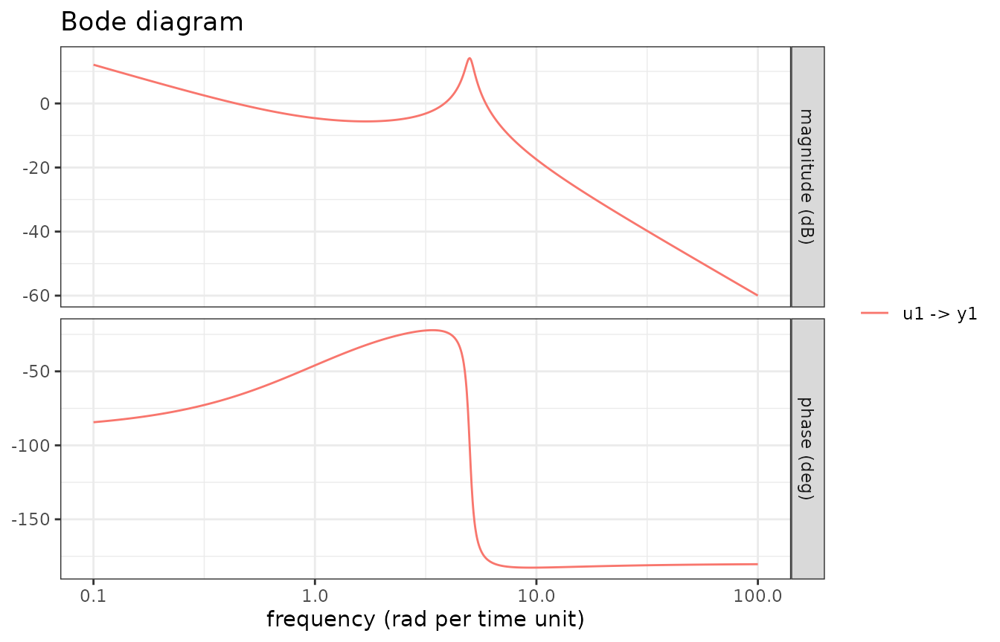
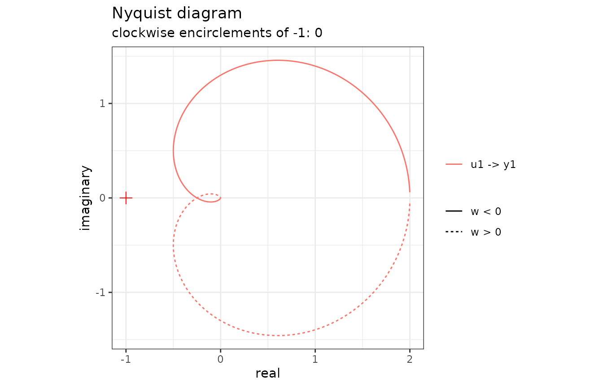
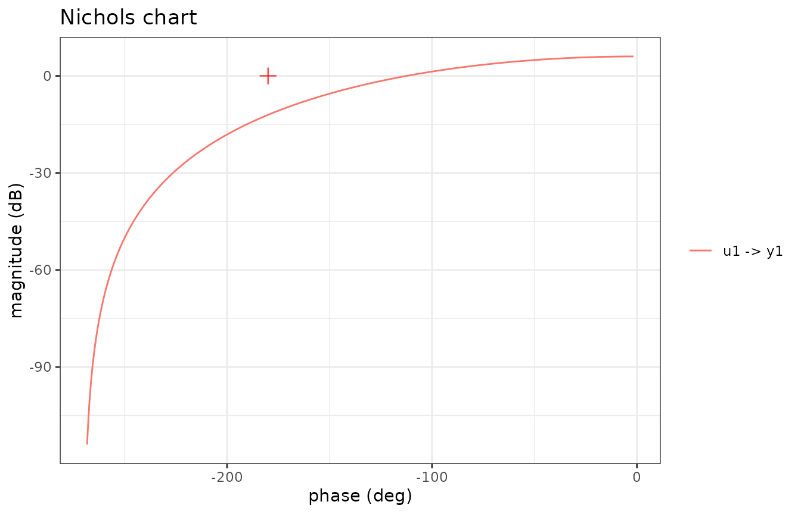

# Frequency response and robustness margins

``` r

library(controlcompR)
```

## Frequency response

[`ctrl_freqresp()`](https://adamrsophie.github.io/controlcompR/reference/ctrl_freqresp.md)
evaluates G(j\omega) (or G(e^{j\omega T})) on a grid, with one complex
linear solve C (j\omega I - A)^{-1} B + D per frequency, so no
polynomial is ever evaluated. The default grid extends one to two
decades beyond the poles and zeros and is denser near lightly damped
modes:

``` r

G <- ctrl_tf(c(10, 10), c(1, 0.4, 25, 0))
fr <- ctrl_freqresp(G, c(0.1, 1, 5))
fr$response[1, 1, ]
#> [1]  0.3937539-4.0022309i  0.4096084-0.4234935i -1.0000000-5.0000000i
plot(ctrl_bode(G))
```



Phase is unwrapped along the grid. If the grid is too coarse near a
resonance the unwrapping can jump; supply a denser `w` when in doubt.

## Nyquist and Nichols plots

``` r

L <- ctrl_tf(2, c(1, 3, 3, 1))
ny <- ctrl_nyquist(L)
ny$encirclements
#> [1] 0
plot(ny)
```



``` r

plot(ctrl_nichols(L))
```



## Gain, phase and delay margins

Margins of the unity negative feedback loop with loop transfer function
`L` are computed from polynomial equations, not by searching a frequency
grid: the phase crossovers are the real roots of \mathrm{Im}\\L(j\omega)
= 0 and the gain crossovers the roots of \|L(j\omega)\| = 1. All
crossings are returned, and the margins refer to the critical ones:

``` r

m <- ctrl_margin(L)
m
#> Stability margins (unity negative feedback)
#>   gain margin: 4 (12.04 dB) at w = 1.732
#>   phase margin: 67.6 deg at w = 0.7664
#>   delay margin: 1.539
#>   nominal closed loop stable: TRUE
m$all_gm
#>   frequency gain_margin
#> 1  1.732051           4
```

The margins only mean something for a loop whose nominal closed loop is
stable, which is reported as `closed_loop_stable`. For multivariable
loops, single-loop margins can be badly optimistic; use disk margins and
singular values.

## Disk margins

A disk margin \alpha guarantees stability under simultaneous gain and
phase variations f in a disk; with skew 0 the guaranteed range is gain
in \[(1 - \alpha/2)/(1 + \alpha/2), (1 + \alpha/2)/(1 - \alpha/2)\]
together with phase \pm 2\arctan(\alpha/2):

``` r

ctrl_disk_margin(L)
#> Disk margin (skew 0): alpha = 0.8093 at w = 1.166
#>   gain margin: [0.4239, 2.359] (-7.456 to 7.456 dB)
#>   phase margin: +/- 44.06 deg
```

## Sensitivity functions

``` r

P <- ctrl_tf(1, c(1, 1, 0))
C <- ctrl_tf(c(3, 1), c(0.1, 1))
g4 <- ctrl_gangof4(P, C)
names(g4)
#> [1] "S"  "T"  "PS" "CS"
ctrl_peak(g4$S)
#> $gain
#> [1] 1.148627
#> 
#> $frequency
#> [1] 8.572122
```

The peak of the sensitivity M_s = \\S\\\_\infty is the inverse of the
distance from the Nyquist curve to the critical point, a single number
that bounds both gain and phase margins.

## System norms

``` r

sys <- ctrl_ss(matrix(c(0, 1, -4, -0.4), 2, byrow = TRUE), c(0, 1), c(1, 0))
ctrl_norm(sys, "2")
#> [1] 0.559017
ctrl_norm(sys, "inf")
#> [1] 1.256297
#> attr(,"frequency")
#> [1] 1.979899
#> attr(,"bounds")
#> [1] 1.256297 1.256297
```

The H2 norm comes from the controllability gramian; the H-infinity norm
from the Bruinsma-Steinbuch iteration on the eigenvalues of a
Hamiltonian matrix, which converges quadratically and returns certified
lower and upper bounds (attribute `bounds`) and the peak frequency. For
the oscillator above the peak is close to the resonance \omega = 2:

``` r

attributes(ctrl_norm(sys, "inf"))
#> $frequency
#> [1] 1.979899
#> 
#> $bounds
#> [1] 1.256297 1.256297
```
