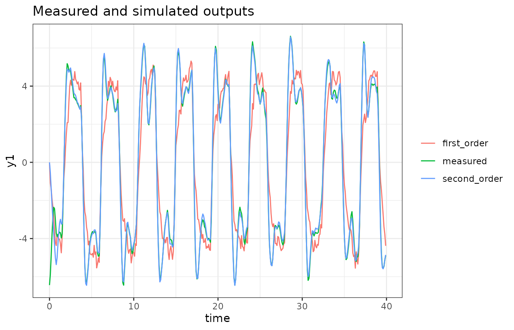
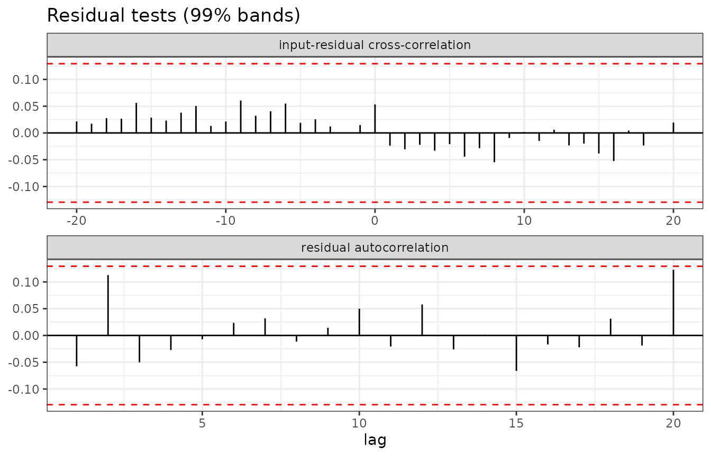

# System identification

``` r

library(controlcompR)
```

System identification builds models from measured data. *controlcompR*
provides ARX estimation and subspace state-space identification
natively, and converts models from the
[sysid](https://cran.r-project.org/package=sysid) package (ARX, ARMAX,
output error, Box-Jenkins and more) so they can be used for design.
Above all, it provides the validation tools that decide whether a model
can be trusted.

## Data

``` r

set.seed(1)
Tn <- 1000
u <- sign(sin(seq_len(Tn) / 7)) + 0.3 * rnorm(Tn)   # rich input
e <- rnorm(Tn, sd = 0.05)
y <- numeric(Tn)
for (k in 3:Tn) {
  y[k] <- 1.5 * y[k - 1] - 0.7 * y[k - 2] + 0.5 * u[k - 1] + 0.25 * u[k - 2] + e[k]
}
data <- ctrl_iddata(y, u, dt = 0.1)
data
#> Identification data: 1000 samples, 1 input(s), 1 output(s), dt = 0.1
parts <- ctrl_idsplit(data, 0.6)
```

Validation data must not be used for estimation.
[`ctrl_idsplit()`](https://adamrsophie.github.io/controlcompR/reference/ctrl_idsplit.md)
keeps the time order (no shuffling, which would destroy the dynamics).

## ARX models

A(q) y_k = B(q) u\_{k-n_k} + e_k is linear in its parameters and is
estimated by least squares with QR:

``` r

arx <- ctrl_arx(parts$estimation, na = 2, nb = 2, nk = 1)
arx
#> Identified ARX model (dt = 0.1)
#>   orders na = 2, nb = 2, nk = 1; noise variance 0.002589
#>   AIC -1860.91, BIC -1843.33
#> Transfer function (discrete time, dt = 0.1)
#> 
#>      0.497 z + 0.256
#>   ----------------------
#>   z^2 - 1.499 z + 0.6999
cbind(estimate = c(arx$a, arx$b), std_error = sqrt(diag(arx$vcov)))
#>        estimate   std_error
#> [1,] -1.4993021 0.002974708
#> [2,]  0.6998862 0.002444879
#> [3,]  0.4970317 0.003646717
#> [4,]  0.2560055 0.004791825
```

The standard errors assume white equation errors. When the noise enters
elsewhere (output error), ARX estimates are biased and their standard
errors meaningless; use an output-error or Box-Jenkins model from
`sysid`.

## Order selection

``` r

tab <- ctrl_arx_order(parts$estimation, na = 1:4, nb = 1:4,
                      validation = parts$validation)
head(tab)
#>    na nb nk npar       aic       bic validation_fit
#> 6   2  2  1    4 -1860.907 -1843.332       86.94238
#> 7   3  2  1    5 -1855.716 -1833.756       86.94243
#> 10  2  3  1    5 -1855.619 -1833.659       86.94238
#> 11  3  3  1    6 -1855.017 -1828.665       86.94300
#> 8   4  2  1    6 -1851.988 -1825.647       86.94205
#> 14  2  4  1    6 -1850.504 -1824.162       86.94152
```

Information criteria (BIC penalizes complexity more than AIC) and the
simulation fit on validation data should agree; when they do not, prefer
the validation data and residual tests.

## Validation: simulation and prediction fit

``` r

cmp <- ctrl_compare(parts$validation,
                    first_order = ctrl_arx(parts$estimation, 1, 1, 1),
                    second_order = arx)
cmp
#>          model output simulation_fit prediction_fit
#> 1  first_order     y1       58.45447       81.03366
#> 2 second_order     y1       86.94238       90.25648
plot(cmp)
```



The simulation fit (input only) is the demanding test for control
design: the one-step prediction of a poor model can look excellent
because it uses past outputs.

## Residual tests

``` r

res <- ctrl_resid(arx, parts$validation)
res
#> Residual analysis (398 samples)
#>   autocorrelation within 99% band: TRUE (Ljung-Box p = 0.307)
#>   input cross-correlation within 99% band (nonnegative lags): TRUE
plot(res)
```



White residuals that are uncorrelated with past inputs indicate that the
model has captured the dynamics. A too simple model fails the tests:

``` r

ctrl_resid(ctrl_arx(parts$estimation, 1, 1, 1), parts$validation)
#> Residual analysis (399 samples)
#>   autocorrelation within 99% band: FALSE (Ljung-Box p = 0)
#>   input cross-correlation within 99% band (nonnegative lags): FALSE
```

## Subspace identification for MIMO systems

[`ctrl_n4sid()`](https://adamrsophie.github.io/controlcompR/reference/ctrl_n4sid.md)
(past-output MOESP) estimates state-space models of any order and
dimension. The singular values of a projected data matrix reveal the
order:

``` r

set.seed(2)
true <- ctrl_ss(matrix(c(0.8, 0.3, -0.3, 0.8), 2), cbind(c(1, 0), c(0.2, 1)),
                rbind(c(1, 0.5), c(0, 1)), dt = 1)
U <- matrix(rnorm(2 * 800), 800)
Y <- ctrl_simulate(true, input = U, times = 0:799)$y[, , 1] +
  matrix(rnorm(1600, sd = 0.02), 800)
ss_model <- ctrl_n4sid(ctrl_iddata(Y, U))
ss_model$order
#> [1] 2
plot(log10(ss_model$singular_values), type = "h", ylab = "log10 singular value")
```


``` r

rbind(estimated = sort(Mod(ctrl_poles(ss_model$sys))),
      true = sort(Mod(ctrl_poles(true))))
#>                [,1]      [,2]
#> estimated 0.8543902 0.8543902
#> true      0.8544004 0.8544004
```

The instruments (past inputs and outputs) make the estimates consistent
in open loop for white or colored output noise. Data recorded in closed
loop bias the estimates.

## Models from sysid

``` r

if (requireNamespace("sysid", quietly = TRUE)) {
  d <- sysid::idframe(output = y[1:600], input = u[1:600], Ts = 0.1)
  armax <- sysid::armax(d, c(2, 2, 1, 1))
  conv <- ctrl_from_sysid(armax)
  print(conv$plant)
  print(ctrl_compare(parts$validation, armax = conv$plant, arx = arx))
}
#> Transfer function (discrete time, dt = 0.1)
#> 
#>     0.4956 z + 0.2568
#>   ----------------------
#>   z^2 - 1.499 z + 0.6998
#>   model output simulation_fit prediction_fit
#> 1 armax     y1       86.94223             NA
#> 2   arx     y1       86.94238       90.25648
```

## From model to controller

A model that fits validation data well is still not automatically
adequate for feedback: what matters is accuracy near the crossover
frequency of the intended loop. Check the model’s frequency response
against nonparametric estimates where possible, design conservatively
and use the robust stability tests of the robust control article with a
weight that reflects the model error.
