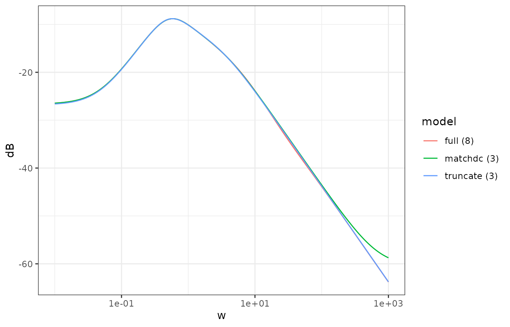

# Model reduction

``` r

library(controlcompR)
```

## Minimal realizations

Uncontrollable or unobservable states do not affect the input-output
behavior.
[`ctrl_minreal()`](https://adamrsophie.github.io/controlcompR/reference/ctrl_minreal.md)
removes them with orthogonal staircase reductions:

``` r

sys <- ctrl_ss(diag(c(-1, -2, -3)), c(1, 1, 0), c(1, 0, 1))
ctrl_minreal(sys)
#> State-space model (continuous time)
#> 1 states, 1 inputs, 1 outputs
#> 
#> A =
#>    x1
#> x1 -1
#> 
#> B =
#>    u1
#> x1  1
#> 
#> C =
#>    x1
#> y1  1
#> 
#> D =
#>    u1
#> y1  0
```

## Hankel singular values

The Hankel singular values \sigma_i = \sqrt{\lambda_i(W_c W_o)} measure
how much each state of a balanced realization contributes to the
input-output map. They are invariant under state transformations:

``` r

set.seed(4)
A <- -diag(c(0.5, 1, 2, 5, 10, 20, 50, 100)) +
  matrix(rnorm(64, sd = 0.3), 8)
B <- matrix(rnorm(8), 8)
C <- matrix(rnorm(8), 1)
big <- ctrl_ss(A, B, C)
ctrl_is_stable(big)
#> [1] TRUE
hsv <- ctrl_hsvd(big)
signif(hsv, 3)
#> [1] 2.07e-01 1.67e-01 1.78e-02 1.23e-03 5.82e-04 1.91e-04 1.06e-05 2.87e-06
plot(hsv, log = "y", type = "b", ylab = "Hankel singular value")
```


## Balanced truncation

Truncating the balanced realization to order r keeps the stable dominant
dynamics and gives the a priori error bound \\G - G_r\\\_\infty \le 2
\sum\_{i \> r} \sigma_i .

``` r

red <- ctrl_balred(big, order = 3)
attr(red, "error_bound")
#> [1] 0.004039388
err <- ctrl_norm(big - red, "inf")
c(actual = as.numeric(err), bound = attr(red, "error_bound"))
#>      actual       bound 
#> 0.002092256 0.004039388
```

The actual error is below the bound, as the theory guarantees.
`method = "matchdc"` (singular perturbation) preserves the DC gain
instead of high-frequency accuracy:

``` r

red_dc <- ctrl_balred(big, order = 3, method = "matchdc")
c(full = ctrl_dcgain(big), truncate = ctrl_dcgain(red), matchdc = ctrl_dcgain(red_dc))
#>       full   truncate    matchdc 
#> 0.04661459 0.04566552 0.04661459
```

## Comparing responses

``` r

w <- 10^seq(-2, 3, length.out = 300)
mag <- function(s) 20 * log10(Mod(ctrl_freqresp(s, w)$response[1, 1, ]))
df <- data.frame(w = rep(w, 3), dB = c(mag(big), mag(red), mag(red_dc)),
                 model = rep(c("full (8)", "truncate (3)", "matchdc (3)"),
                             each = length(w)))
ggplot2::ggplot(df, ggplot2::aes(w, dB, color = model)) + ggplot2::geom_line() +
  ggplot2::scale_x_log10() + ggplot2::theme_bw()
```



## Unstable models

Balanced truncation is defined for stable models. For unstable models
the package separates the stable and unstable parts with
[`ctrl_stabsep()`](https://adamrsophie.github.io/controlcompR/reference/ctrl_stabsep.md),
reduces the stable part and keeps the unstable part exactly:

``` r

unst <- ctrl_ss(as.matrix(Matrix::bdiag(A, matrix(0.5))),
                rbind(B, 1), cbind(C, 1))
parts <- ctrl_stabsep(unst)
ctrl_poles(parts$unstable)
#> [1] 0.5+0i
red_u <- ctrl_balred(unst, order = 4)
sort(Re(ctrl_poles(red_u)), decreasing = TRUE)[1]
#> [1] 0.5
```
