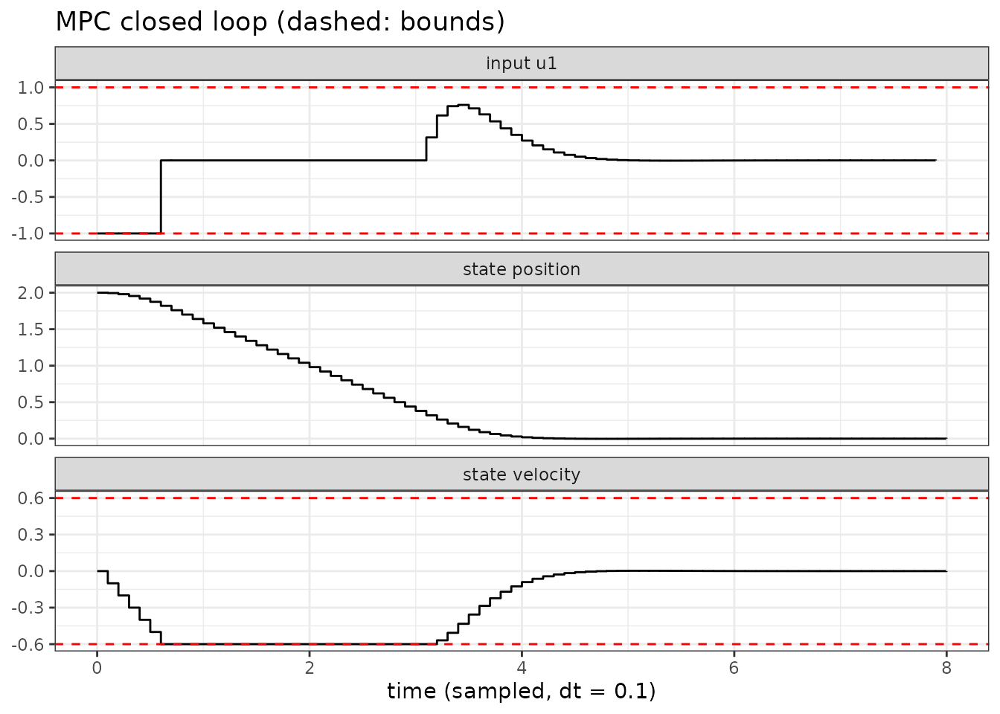
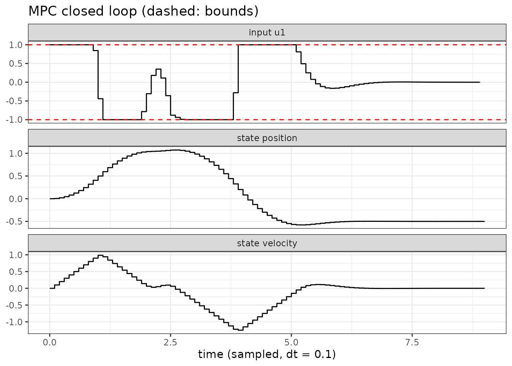

# Linear model predictive control

``` r

library(controlcompR)
```

Model predictive control (MPC) solves, at every sample, a finite-horizon
optimal control problem from the current state, applies the first input
and repeats. Constraints on inputs, input rates, states and outputs are
part of the problem, which is the reason to use MPC.

## The optimization problem

For the discrete model x\_{k+1} = A x_k + B u_k, y_k = Cx_k + Du_k,
[`ctrl_mpc()`](https://adamrsophie.github.io/controlcompR/reference/ctrl_mpc.md)
sets up \min \sum\_{k=0}^{N-1} \Big\[\\x_k - x^r_k\\\_Q^2 + \\u_k -
u^r_k\\\_R^2 + \\y_k - y^r_k\\\_{Q_y}^2 + \\\Delta
u_k\\\_{R_d}^2\Big\] + \\x_N - x^r_N\\\_P^2 subject to x_0 = x(t), the
dynamics, and

- input bounds u\_{\min} \le u_k \le u\_{\max}, k = 0, \ldots, N-1;
- rate bounds on \Delta u_k = u_k - u\_{k-1}, where u\_{-1} is the input
  applied at the previous sample;
- state bounds on x_1, \ldots, x_N and output bounds on y_1, \ldots, y_N
  (the current state cannot be changed);
- the control horizon: u_k = u\_{N_c - 1} for k \ge N_c;
- optionally a terminal equality or polyhedral terminal set.

The input u_k acts between x_k and x\_{k+1}, so the first predicted
state the decision affects is x_1.

## A double integrator with limits

``` r

plant <- ctrl_c2d(ctrl_ss(matrix(c(0, 1, 0, 0), 2, byrow = TRUE), c(0, 1),
                          c(1, 0), state_names = c("position", "velocity")), 0.1)
mpc <- ctrl_mpc(plant, horizon = 20, Q = diag(c(10, 1)), R = 0.1,
                u_min = -1, u_max = 1,
                x_min = c(-Inf, -0.6), x_max = c(Inf, 0.6))
mpc
#> Linear MPC (dt = 0.1): horizon 20, control horizon 20
#>   62 decision variables, 82 constraint rows
#>   u in [-1] .. [1]
#>   x in [-Inf, -0.6] .. [Inf, 0.6]
```

### One step and the predicted plan

``` r

step <- ctrl_mpc_step(mpc, x = c(2, 0))
step
#> MPC step: status "solved"
#>   u = -1
#>   objective: 539.874, iterations: 1175, max bound violation: 1.97e-09
head(step$x_plan)
#>       [,1]          [,2]
#> [1,] 2.000 -9.391703e-13
#> [2,] 1.995 -1.000000e-01
#> [3,] 1.980 -2.000000e-01
#> [4,] 1.955 -3.000000e-01
#> [5,] 1.920 -4.000000e-01
#> [6,] 1.875 -5.000000e-01
head(step$u_plan)
#>      [,1]
#> [1,]   -1
#> [2,]   -1
#> [3,]   -1
#> [4,]   -1
#> [5,]   -1
#> [6,]   -1
```

Every step reports the solver status, the objective (including
constants, so it equals the cost of the plan), the largest bound
violation of the returned plan and the residual of the dynamics
equations. These diagnostics make solver tolerance problems visible.

### The receding-horizon loop

``` r

sim <- ctrl_simulate_mpc(mpc, x0 = c(2, 0), steps = 80)
summary(sim)
#> MPC simulation: 80 samples, 0 failed solves (0%)
#>   solver statuses: solved = 80
#>   solve time: mean 0.000464 s, max 0.00141 s; mean iterations 392.2
#>   max input bound violation: 3.26e-11
#>   max state bound violation (true plant): 0
#>   max slack: 0
plot(sim)
```



The velocity stays within its limit of 0.6 and the input within one.

## The QP behind it

The problem is assembled once as a sparse QP in OSQP form, \min \frac12
z^\top H z + q^\top z subject to l \le A z \le u, with z = (x_0, \ldots,
x_N, u_0, \ldots, u\_{N-1}). Only `q`, `l` and `u` change from sample to
sample, so OSQP reuses its factorization and starts from the shifted
previous solution.
[`ctrl_mpc_qp()`](https://adamrsophie.github.io/controlcompR/reference/ctrl_mpc_qp.md)
exposes the matrices:

``` r

qp <- ctrl_mpc_qp(mpc, x = c(2, 0))
dim(qp$H)
#> [1] 62 62
dim(qp$A)
#> [1] 82 62
Matrix::nnzero(qp$A) / prod(dim(qp$A))  # sparsity
#> [1] 0.03579858
qp$xi(1)  # positions of x_1 in z
#> [1] 3 4
qp$ui(0)  # position of u_0 in z
#> [1] 43
```

Before calling the solver, the weights are checked: `Q`, `P`, `Qy` and
`Rd` must be positive semidefinite and `R + Rd` positive definite, so
the QP is convex and strictly convex in the inputs.

### Verifying the formulation

Without active constraints and with the LQR cost-to-go as terminal
weight, the MPC law must equal the LQR law u = -Kx exactly. This is one
of the package tests:

``` r

mpc_free <- ctrl_mpc(plant, horizon = 10, Q = diag(c(1, 0.5)), R = 0.2, P = "lqr")
K <- ctrl_lqr(plant, diag(c(1, 0.5)), 0.2)$K
c(mpc = ctrl_mpc_step(mpc_free, c(1, 0))$u, lqr = drop(-K %*% c(1, 0)))
#>    mpc.u1    lqr.u1 
#> -1.959771 -1.959771
```

## Tracking a reference

References may be constant vectors, matrices with one row per stage
(preview) or functions of the time index:

``` r

mpc_y <- ctrl_mpc(plant, horizon = 20, Q = 0, Qy = 10, R = 0.1,
                  u_min = -1, u_max = 1)
ref <- function(k) if (k < 40) 1 else -0.5
sim_y <- ctrl_simulate_mpc(mpc_y, x0 = c(0, 0), steps = 90,
                           reference = list(y = ref))
plot(sim_y)
```



## Infeasibility and failure handling

Hard constraints can make the problem infeasible, for example when the
state already violates a bound or the input is too weak to keep it. A
failed solve never returns an input silently:

``` r

tight <- ctrl_mpc(plant, horizon = 5, Q = diag(2), R = 1, u_min = -0.1,
                  u_max = 0.1, x_min = c(-Inf, -0.05), x_max = c(Inf, 0.05))
st <- ctrl_mpc_step(tight, c(0, 1))
st$ok
#> [1] FALSE
st$status
#> [1] "primal infeasible"
```

In a closed-loop simulation the default `on_failure = "stop"` raises an
error. The explicit fallbacks `"hold"` (keep the previous input) and
`"shifted"` (use the next move of the last successful plan) are recorded
in the log:

``` r

sim_f <- ctrl_simulate_mpc(tight, c(0, 1), steps = 5, on_failure = "hold")
sim_f$log[, c("k", "status", "fallback")]
#>   k            status fallback
#> 1 1 primal infeasible     hold
#> 2 2 primal infeasible     hold
#> 3 3 primal infeasible     hold
#> 4 4 primal infeasible     hold
#> 5 5 primal infeasible     hold
```

Soft constraints (next article) are the usual remedy.

## Stability is not automatic

A successful QP solve at every sample does not imply closed-loop
stability. With `P = "lqr"`, stability holds near the origin where the
constraints are inactive; with active constraints one needs a terminal
set that is invariant under the LQR law, or `terminal = "equality"`. The
terminal equality gives recursive feasibility and stability only when
the reference is an admissible equilibrium of the model (its state and
input satisfy the bounds and the dynamics), the first problem is
feasible, and the full horizon is free (no shorter control horizon, no
rate bounds); a reference that is not an equilibrium can make the next
problem infeasible. Short horizons with `P = Q` can destabilize unstable
plants.

## Comparing controllers

``` r

lqr <- ctrl_lqr(plant, diag(c(10, 1)), 0.1)
sat_lqr <- function() {
  x <- c(2, 0)
  X <- matrix(0, 81, 2)
  U <- numeric(80)
  X[1, ] <- x
  for (k in 1:80) {
    U[k] <- max(-1, min(1, -drop(lqr$K %*% x)))
    x <- drop(plant$A %*% x + plant$B * U[k])
    X[k + 1, ] <- x
  }
  list(time = (0:79) * 0.1, y = X[1:80, 1], u = U, v = X[, 2])
}
mpc_run <- function() {
  s <- ctrl_simulate_mpc(mpc, c(2, 0), 80)
  list(time = s$time[1:80], y = s$y[, 1], u = s$u[, 1])
}
ctrl_compare_controllers(list(saturated_lqr = sat_lqr, mpc = mpc_run),
                         reference = 0, u_min = -1, u_max = 1)
#>      controller      IAE      ISE     ITAE      RMSE control_effort max_abs_u
#> 1 saturated_lqr 3.188662 4.417522 3.589068 0.7597304      3.5171881         1
#> 2           mpc 3.957788 5.612446 4.915165 0.8523824      0.8770798         1
#>   max_violation  convention
#> 1  0.000000e+00 trapezoidal
#> 2  1.252676e-10 trapezoidal
```

The saturated LQR is faster here only because it ignores the velocity
limit of 0.6, which MPC respects:

``` r

c(saturated_lqr = max(abs(sat_lqr()$v)), mpc = max(abs(sim$x[, 2])))
#> saturated_lqr           mpc 
#>           1.5           0.6
```
