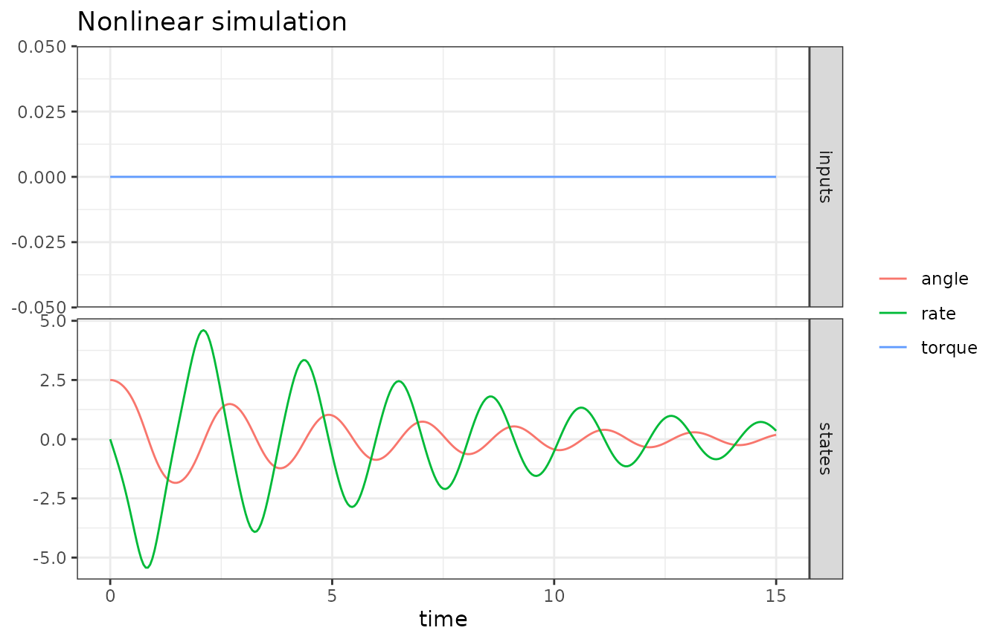
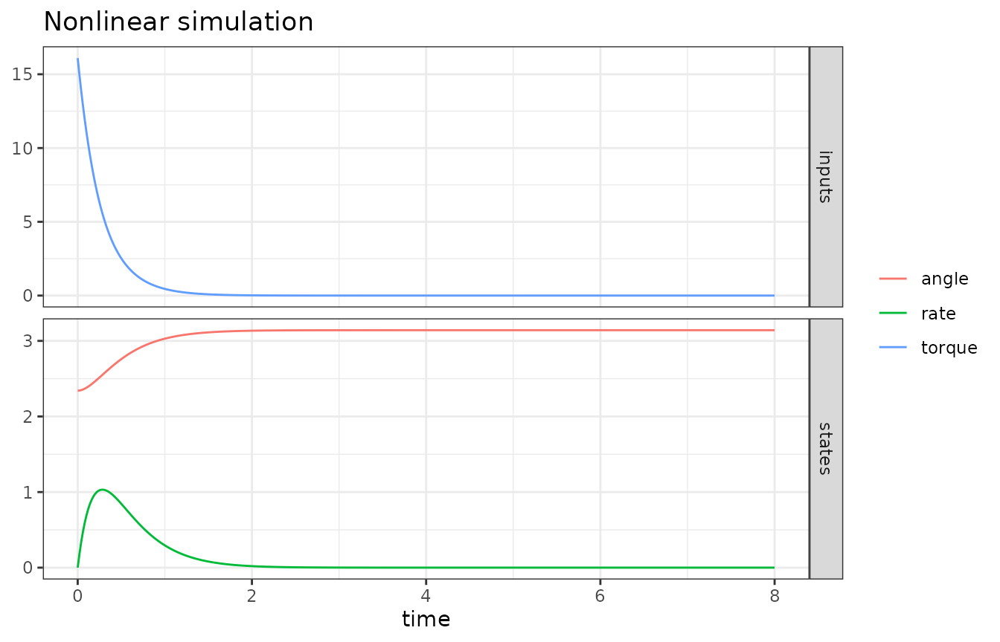
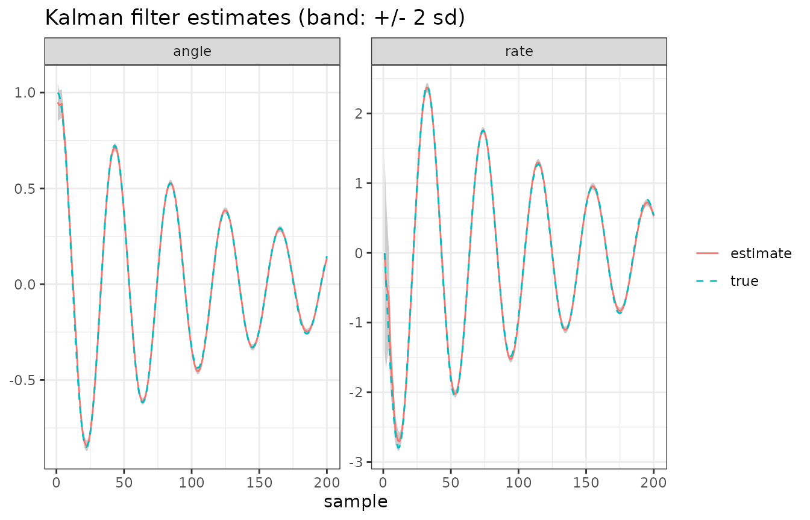
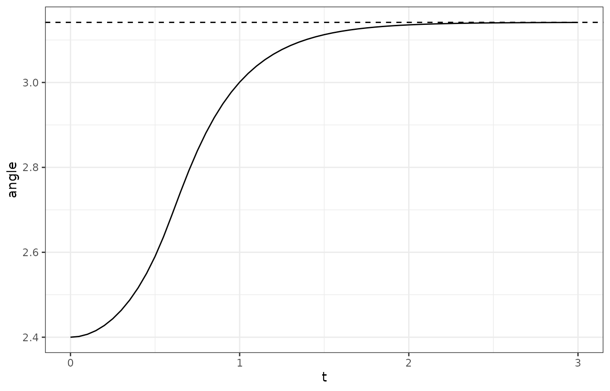

# Nonlinear systems

``` r

library(controlcompR)
```

## Defining a nonlinear model

A pendulum with damping and a torque input, \ddot\theta =
-\frac{g}{l}\sin\theta - c\\\dot\theta + u:

``` r

pendulum <- ctrl_nlsys(
  update = function(t, x, u, p) c(x[2], -p$g / p$l * sin(x[1]) - p$c * x[2] + u),
  output = function(t, x, u, p) x[1],
  nstates = 2, ninputs = 1,
  params = list(g = 9.81, l = 1, c = 0.3),
  state_names = c("angle", "rate"), input_names = "torque",
  output_names = "angle"
)
pendulum
#> Nonlinear model (continuous time): 2 states, 1 inputs, 1 outputs
```

`update` returns the derivative for continuous models (`dt = NULL`) or
the next state for discrete models.

## Simulation

Continuous models are integrated with `deSolve` (adaptive `lsoda` by
default, tight tolerances). Inputs given as samples are held constant
between time points; a `controller(t, x)` is evaluated at the time
points and held, which simulates a sampled-data controller:

``` r

free <- ctrl_nl_simulate(pendulum, x0 = c(2.5, 0), times = seq(0, 15, 0.05))
plot(free)
```



## Equilibria and linearization

``` r

up <- ctrl_equilibrium(pendulum, x0 = c(3, 0))
up$x
#> [1]  3.141593e+00 -5.329336e-26
up$stability
#> [1] "unstable"
down <- ctrl_equilibrium(pendulum, x0 = c(0.3, 0))
down$stability
#> [1] "locally asymptotically stable"
```

[`ctrl_linearize()`](https://adamrsophie.github.io/controlcompR/reference/ctrl_linearize.md)
returns the Jacobian model in deviation variables. The Jacobians come
from central finite differences unless analytic ones are supplied, and
the method is recorded:

``` r

lin <- ctrl_linearize(pendulum, x0 = c(pi, 0), u0 = 0)
lin$A
#>      [,1] [,2]
#> [1,] 0.00  1.0
#> [2,] 9.81 -0.3
attr(lin, "method")
#> [1] "central finite differences"
ctrl_poles(lin)
#> [1]  2.985682+0i -3.285682+0i
```

The linearization is a first-order statement about a neighborhood of the
operating point; its stability verdict is local. An equilibrium whose
linearization has poles on the stability boundary is reported as
inconclusive, because the nonlinear terms decide.

## Stabilizing the upright position

Design LQR on the linearization and apply it to the nonlinear plant in
deviation variables:

``` r

K <- ctrl_lqr(lin, Q = diag(c(10, 1)), R = 1)$K
ctrl_fb <- function(t, x) -drop(K %*% (x - c(pi, 0)))
for (a0 in c(0.3, 0.8)) {
  sim <- ctrl_nl_simulate(pendulum, x0 = c(pi - a0, 0),
                          times = seq(0, 8, 0.02), controller = ctrl_fb)
  cat("initial offset", a0, ": final angle error",
      signif(abs(sim$x[nrow(sim$x), 1] - pi), 3), "\n")
}
#> initial offset 0.3 : final angle error 3.03e-11 
#> initial offset 0.8 : final angle error 6.74e-11
plot(sim)
```



The region of attraction of the linear design is limited; large initial
errors or input limits need other methods (energy shaping, NMPC).

## Discretization

[`ctrl_nl_discretize()`](https://adamrsophie.github.io/controlcompR/reference/ctrl_nl_discretize.md)
builds a discrete model whose update integrates the continuous one over
a sample with the input held constant, either with `deSolve` or with
fixed-step classical Runge-Kutta:

``` r

pd <- ctrl_nl_discretize(pendulum, dt = 0.05, method = "rk4")
pd
#> Nonlinear model (discrete time, dt = 0.05): 2 states, 1 inputs, 1 outputs
```

## Extended and unscented Kalman filters

``` r

set.seed(3)
f <- pd$update
Tn <- 200
x <- c(1, 0)
X <- matrix(0, Tn, 2)
y <- numeric(Tn)
for (k in 1:Tn) {
  X[k, ] <- x
  y[k] <- x[1] + rnorm(1, sd = 0.05)
  x <- f(k - 1, x, 0, pd$params) + rnorm(2, sd = c(1e-3, 5e-3))
}
ekf <- ctrl_ekf(pd, y, u = rep(0, Tn), Qn = diag(c(1e-6, 2.5e-5)), Rn = 0.0025,
                x0 = c(0.5, 0), P0 = diag(c(0.5, 0.5)))
ukf <- ctrl_ukf(pd, y, u = rep(0, Tn), Qn = diag(c(1e-6, 2.5e-5)), Rn = 0.0025,
                x0 = c(0.5, 0), P0 = diag(c(0.5, 0.5)))
c(ekf = sqrt(mean((ekf$filtered[, 2] - X[, 2])^2)),
  ukf = sqrt(mean((ukf$filtered[, 2] - X[, 2])^2)))
#>        ekf        ukf 
#> 0.06018709 0.06038332
c(ekf_mean_nis = mean(ekf$nis), ukf_mean_nis = mean(ukf$nis))
#> ekf_mean_nis ukf_mean_nis 
#>    0.9558170    0.9561342
plot(ukf, truth = X)
```



The EKF linearizes at the current estimate; the UKF propagates sigma
points and needs no Jacobians. Both are approximations whose covariances
are not guaranteed to be consistent; the mean normalized innovation
squared should be near the number of outputs (here 1).

## Nonlinear MPC (experimental)

[`ctrl_nmpc()`](https://adamrsophie.github.io/controlcompR/reference/ctrl_nmpc.md)
solves a single-shooting problem with hard input bounds and soft
(penalized) state bounds using L-BFGS-B. Bringing the pendulum from 2.4
rad to the upright position with limited torque, far outside the region
where the linearization is accurate:

``` r

nmpc <- ctrl_nmpc(pd, horizon = 20, Q = diag(c(10, 1)), R = 0.01,
                  P = diag(c(100, 10)), u_min = -8, u_max = 8)
sim_n <- ctrl_simulate_nmpc(nmpc, x0 = c(2.4, 0), steps = 60,
                            x_ref = c(pi, 0), on_failure = "hold")
sim_n$failures
#> [1] 0
tail(sim_n$x, 1)
#>          angle         rate
#> [61,] 3.141344 0.0007897875
df <- data.frame(t = sim_n$time, angle = sim_n$x[, 1])
ggplot2::ggplot(df, ggplot2::aes(t, angle)) + ggplot2::geom_line() +
  ggplot2::geom_hline(yintercept = pi, linetype = "dashed") + ggplot2::theme_bw()
```



The problem is nonconvex: the result is a local optimum that depends on
the initial guess (started from rest at the bottom, this controller
stalls at a local optimum instead of swinging up), finite-difference
gradients make each solve expensive, and no stability guarantee is
provided. Treat NMPC results as experiments, verified by simulation.
