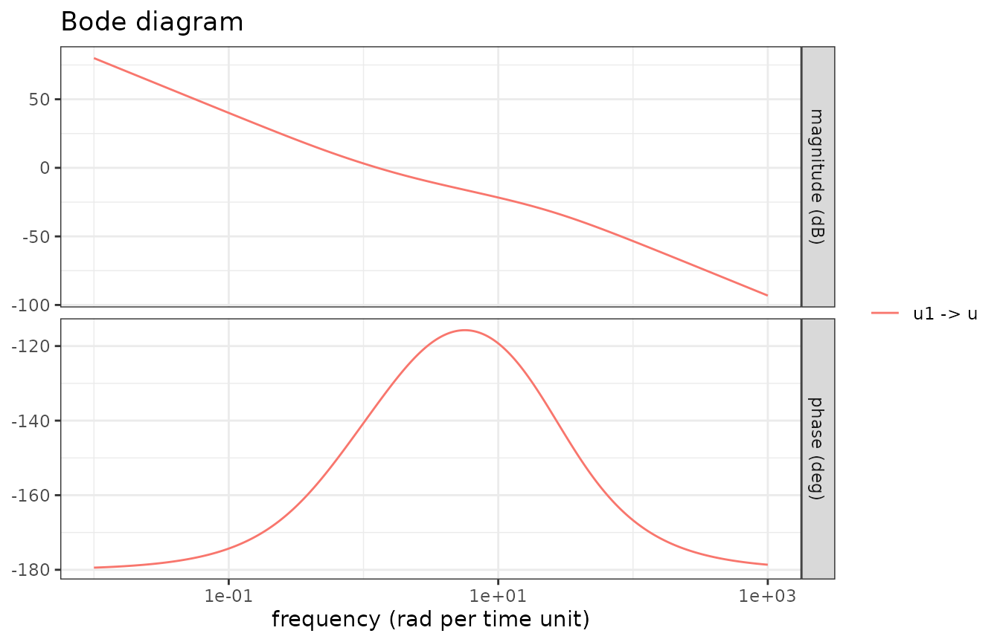
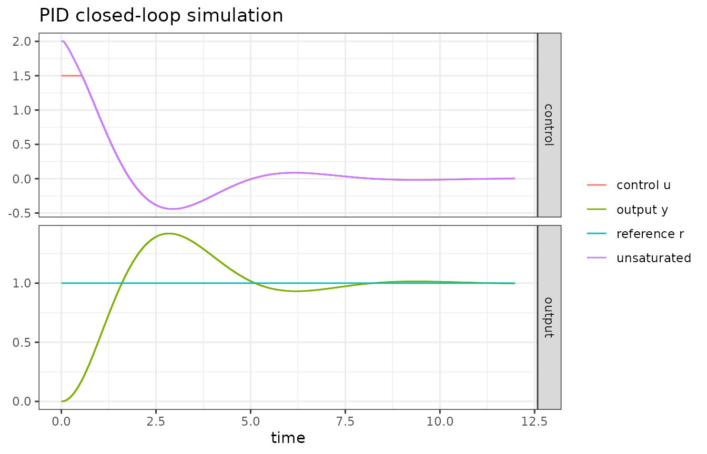
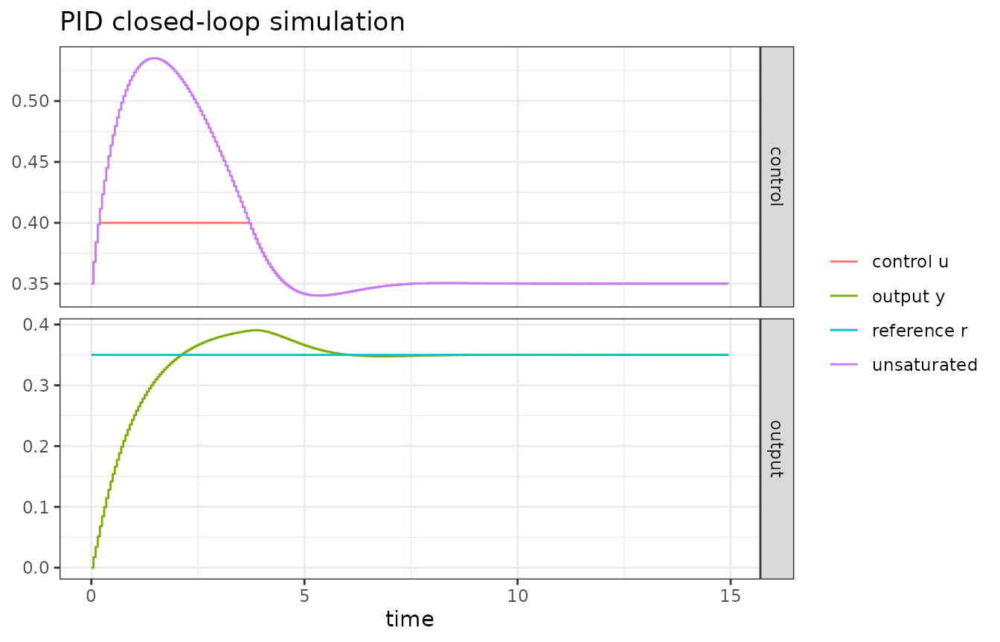
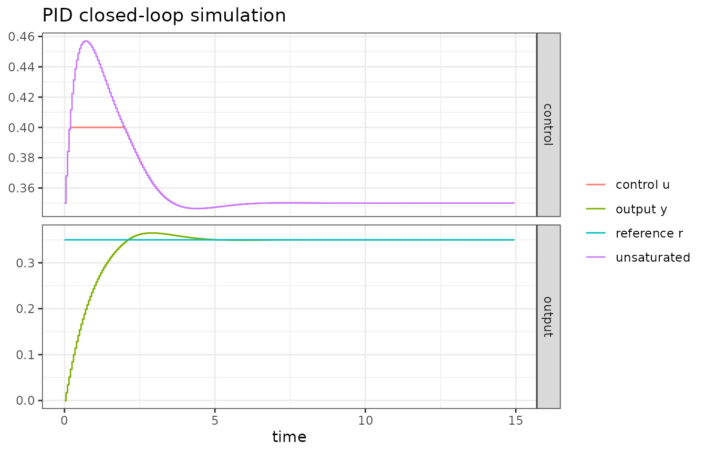
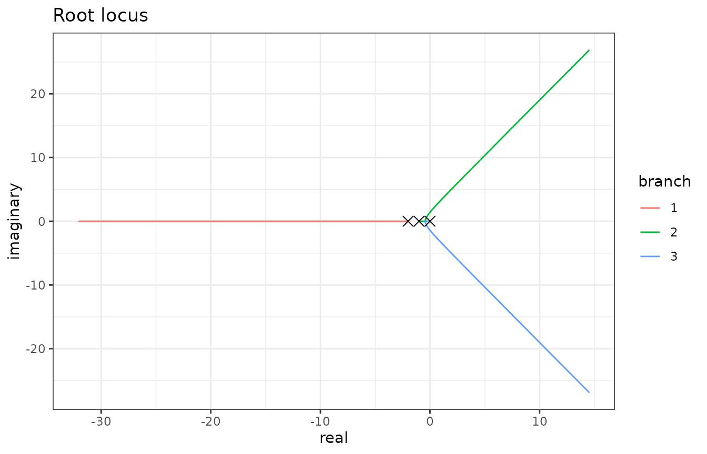

# PID control

``` r

library(controlcompR)
```

A textbook PID law k_p e + k_i \int e + k_d \dot e is not implementable
as written: the derivative is improper, amplifies measurement noise
without bound, and the integrator winds up whenever the actuator
saturates.
[`ctrl_pid()`](https://adamrsophie.github.io/controlcompR/reference/ctrl_pid.md)
therefore always includes the features a working controller needs:

u = k_p (b\\r - y) + k_i \int (r - y)\\dt + k_d \frac{d}{dt}
\frac{c\\r - y}{T_f s + 1},

with setpoint weights `b` and `c` (the default `c = 0` avoids a
derivative kick on setpoint steps), a derivative filter `Tf`, output
saturation and anti-windup.

## Defining a controller

``` r

pid <- ctrl_pid(kp = 2, ki = 1, kd = 0.8, derivative_filter = 10,
                u_min = -1.5, u_max = 1.5, dt = 0.02)
pid
#> PID controller (discrete, dt = 0.02)
#>   kp = 2, ki = 1, kd = 0.8, Tf = 0.04
#>   setpoint weights b = 1, c = 0
#>   saturation [-1.5, 1.5], anti-windup: backcalc
```

`derivative_filter = N` sets T_f = T_d / N with T_d = k_d / k_p. Asking
for a derivative term without a filter is an error. The standard (ISA)
form uses T_i and T_d:

``` r

ctrl_pid(kp = 2, ki = 4, kd = 0.25, form = "standard", derivative_filter = 8)
#> PID controller (continuous description)
#>   kp = 2, ki = 0.5, kd = 0.5, Tf = 0.03125
#>   setpoint weights b = 1, c = 0
#>   saturation [-Inf, Inf], anti-windup: backcalc
```

## Linear analysis

Ignoring saturation,
[`ctrl_pid_tf()`](https://adamrsophie.github.io/controlcompR/reference/ctrl_pid_tf.md)
returns the controller as a transfer function. A controller without a
sample interval gives the continuous design; with one it is the exact
discrete equivalent of the implemented difference equations (forward
Euler integral, backward Euler derivative filter), so its margins,
computed against the zero-order-hold plant, are those of the code that
runs:

``` r

plant <- ctrl_tf(1, c(1, 1, 0))
C <- ctrl_pid_tf(ctrl_pid(kp = 2, ki = 1, kd = 0.8, derivative_filter = 10))
C
#> Transfer function (continuous time)
#> 
#>      22 s^2 +    51 s +    25
#>   ---------------------------
#>          s^2 +    25 s
L <- C * plant
ctrl_margin(L)
#> Stability margins (unity negative feedback)
#>   gain margin: Inf (Inf dB) at w = NA
#>   phase margin: 44.58 deg at w = 1.275
#>   delay margin: 0.6104
#>   nominal closed loop stable: TRUE
plot(ctrl_bode(L))
```



``` r


Cd <- ctrl_pid_tf(ctrl_pid(kp = 2, ki = 1, kd = 0.8, derivative_filter = 10,
                           dt = 0.02))
ctrl_margin(Cd * ctrl_c2d(plant, 0.02))
#> Stability margins (unity negative feedback)
#>   gain margin: 104.4 (40.37 dB) at w = 40.67
#>   phase margin: 43.82 deg at w = 1.276
#>   delay margin: 0.5995
#>   nominal closed loop stable: TRUE
```

The sampled loop loses a little phase (the hold behaves like a delay of
half a sample), which is why the discrete margins are slightly smaller.

## Closed-loop simulation with saturation

[`ctrl_simulate_pid()`](https://adamrsophie.github.io/controlcompR/reference/ctrl_simulate_pid.md)
runs the discrete controller against the plant (a continuous plant is
discretized exactly with a zero-order hold at the controller sample
interval):

``` r

sim <- ctrl_simulate_pid(plant, pid, reference = 1, steps = 600)
plot(sim)
```



``` r

ctrl_performance(sim$time, sim$y, sim$r, u = sim$u, u_min = -1.5, u_max = 1.5)
#>       IAE      ISE    ITAE    RMSE control_effort max_abs_u max_violation
#> 1 1.96389 1.001498 4.29645 0.29033       2.388996       1.5             0
```

A plant with direct feedthrough makes the measurement depend on the
input of the same sample. The controller output before saturation is
affine in the measurement, so the simulator solves this algebraic loop
exactly (with saturation) instead of inserting a hidden delay:

``` r

lead <- ctrl_c2d(ctrl_tf(c(0.5, 1), c(1, 1)), pid$dt)   # D = 0.5
sim_ft <- ctrl_simulate_pid(lead, ctrl_pid(kp = 1, ki = 2, dt = pid$dt),
                            reference = 1, steps = 5)
sim_ft[, c("time", "y", "u")]
#>   time         y         u
#> 1 0.00 0.3333333 0.6666667
#> 2 0.02 0.3466225 0.6800441
#> 3 0.04 0.3597357 0.6930661
#> 4 0.06 0.3726728 0.7057395
#> 5 0.08 0.3854339 0.7180715
```

## Anti-windup

When the actuator saturates, an unprotected integrator keeps growing and
the response overshoots badly once the error changes sign.
Back-calculation feeds the difference between the saturated and
unsaturated outputs back into the integrator with gain `kt`; clamping
stops integration while the output is saturated in the direction of the
error:

``` r

plant2 <- ctrl_tf(1, c(1, 1))
mk <- function(aw) ctrl_pid(kp = 1, ki = 2, u_min = -0.4, u_max = 0.4,
                            antiwindup = aw, dt = 0.05)
runs <- lapply(c(none = "none", backcalc = "backcalc", clamp = "clamp"),
               function(aw) ctrl_simulate_pid(plant2, mk(aw), reference = 0.35,
                                              steps = 300))
sapply(runs, function(s) c(overshoot = max(s$y) - 0.35, max_integrator = max(s$I)))
#>                     none   backcalc      clamp
#> overshoot      0.0406833 0.01488736 0.01113191
#> max_integrator 0.5183408 0.39461983 0.38336489
plot(runs$none)
```



``` r

plot(runs$backcalc)
```



## Bumpless transfer

In manual mode the controller output follows an operator value while the
integrator tracks it, so switching to automatic mode does not cause a
jump:

``` r

manual <- c(rep(0.2, 100), rep(NA, 200))
sim_bt <- ctrl_simulate_pid(plant2, ctrl_pid(kp = 1, ki = 1, dt = 0.05),
                            reference = 0.5, steps = 300, manual = manual)
sim_bt$u[99:102]
#> [1] 0.2000000 0.2000000 0.1999309 0.2149359
```

## Tuning rules

Tuning rules are heuristics and starting points. The Ziegler-Nichols
frequency-response rule uses the ultimate gain and period (from the gain
margin and phase crossover); SIMC and AMIGO use a first-order plus
dead-time model, which
[`ctrl_fit_fopdt()`](https://adamrsophie.github.io/controlcompR/reference/ctrl_fit_fopdt.md)
estimates from a step response:

``` r

plant3 <- ctrl_tf(1, c(1, 3, 3, 1))
fit <- ctrl_fit_fopdt(plant3)
fit
#>        K      tau    theta 
#>  1.00000 86.53948 17.93607
zn <- ctrl_pid_tune("ziegler_nichols", plant = plant3, derivative_filter = 10,
                    dt = 0.05)
simc <- ctrl_pid_tune("simc", fopdt = fit, dt = 0.05)
amigo <- ctrl_pid_tune("amigo", fopdt = fit, dt = 0.05)
ctrl_compare_controllers(list(
  ziegler_nichols = function() ctrl_simulate_pid(plant3, zn, steps = 600),
  simc = function() ctrl_simulate_pid(plant3, simc, steps = 600),
  amigo = function() ctrl_simulate_pid(plant3, amigo, steps = 600)
), reference = 1)
#>        controller       IAE      ISE       ITAE      RMSE control_effort
#> 1 ziegler_nichols  2.299335 1.253245   5.685068 0.2064175       55.31573
#> 2            simc  8.310740 2.986853 110.440255 0.3169194       22.66202
#> 3           amigo 13.100333 6.205627 177.892905 0.4558494       12.16790
#>   max_abs_u max_violation
#> 1  5.267316             0
#> 2  2.414330             0
#> 3  1.154471             0
```

Ziegler-Nichols is aggressive (low damping); SIMC and AMIGO trade speed
for robustness. Always check margins and a simulation with realistic
saturation and noise before using a tuned controller.

## Root locus

``` r

plot(ctrl_rlocus(ctrl_tf(1, c(1, 3, 2, 0))))
```


