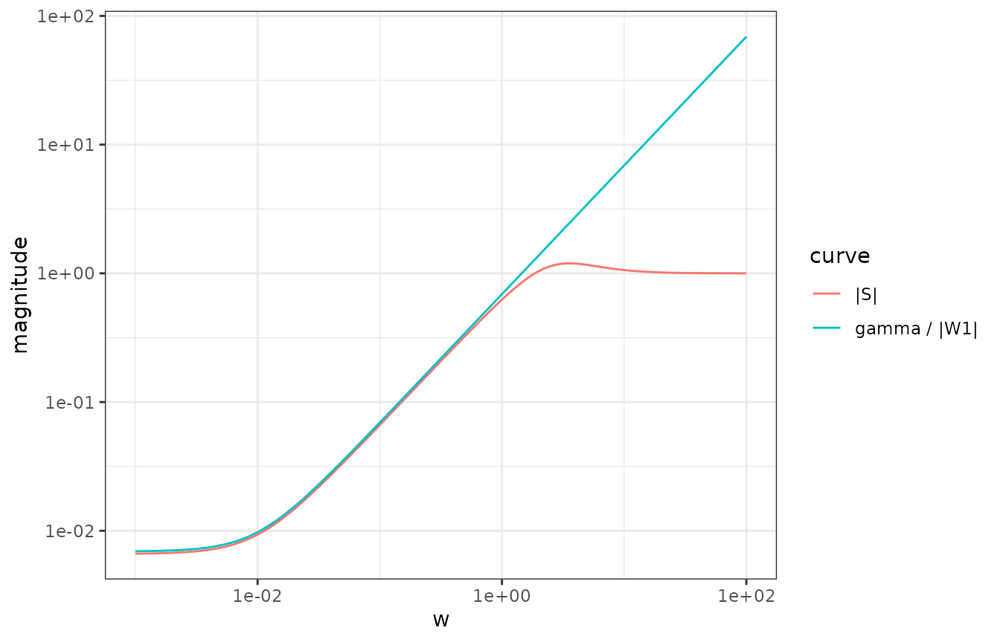

# Robust control

``` r

library(controlcompR)
```

Robust control asks whether a controller keeps the loop stable, and
performing well, for every plant in a set, not just for the nominal
model. For every method below the article states the uncertainty model,
the guarantee, the algorithm and the limits. Nominal stability (the
design model) and robust stability (the whole set) are different claims;
a controller that works on a few sampled plants has not been shown to be
robust.

## Unstructured uncertainty and the small-gain theorem

Three standard families describe the true plant G\_\Delta with a stable
perturbation \\\Delta\\\_\infty \le 1 and a frequency weight W:

| family                | true plant      | robust stability iff   |
|-----------------------|-----------------|------------------------|
| multiplicative output | (I + W\Delta) G | \\T W\\\_\infty \< 1   |
| multiplicative input  | G (I + W\Delta) | \\T_i W\\\_\infty \< 1 |
| additive              | G + W \Delta    | \\K S W\\\_\infty \< 1 |

with S = (I + GK)^{-1}, T = GKS and T_i = KG(I + KG)^{-1}. These
conditions are necessary and sufficient for unstructured complex
perturbations (given nominal internal stability and the same number of
unstable poles for all plants); they can be conservative for structured
or real parametric uncertainty.

A weight that is small at low frequency and grows past one at high
frequency says: the model is accurate to 10 percent at low frequency and
unreliable (up to 200 percent error) at high frequency:

``` r

G <- ctrl_tf(1, c(1, 1))
W <- ctrl_tf(c(0.2, 0.1), c(0.1, 1))   # 0.1 at DC, 2 at high frequency
for (k in c(2, 5, 20)) {
  rs <- ctrl_robust_stability(G, ctrl_tf(k, 1), W)
  cat("K =", k, ": peak", signif(rs$peak, 3), "robustly stable:",
      rs$robustly_stable, "\n")
}
#> K = 2 : peak 0.309 robustly stable: TRUE 
#> K = 5 : peak 0.626 robustly stable: TRUE 
#> K = 20 : peak 1.29 robustly stable: FALSE
```

The returned `margin = 1 / peak` is the largest scaling of the
uncertainty that the loop tolerates.

## Generalized plants

Optimal synthesis works with a generalized plant `P` with exogenous
inputs `w` (disturbances, noise, references), controls `u`, performance
outputs `z` and measurements `y`.
[`ctrl_lft()`](https://adamrsophie.github.io/controlcompR/reference/ctrl_lft.md)
closes the loop `u = K y`:

``` r

A <- matrix(c(0, 1, 0, 0), 2, byrow = TRUE)
# w = (process noise on both states, sensor noise), u = force
# z = (position, control effort), y = noisy position
P <- ctrl_ss(A, cbind(diag(2), 0, c(0, 1)),
             rbind(c(1, 0), c(0, 0), c(1, 0)),
             rbind(c(0, 0, 0, 0), c(0, 0, 0, 1), c(0, 0, 1, 0)))
```

## H2 synthesis

[`ctrl_h2syn()`](https://adamrsophie.github.io/controlcompR/reference/ctrl_h2syn.md)
minimizes \\T\_{zw}\\\_2, the root-mean-square response of `z` to unit
white noise `w`. The solution uses two Riccati equations, one for the
regulator and one for the filter (Zhou, Doyle and Glover, Theorem 14.7).
It needs D\_{11} = 0, D\_{12} of full column rank, D\_{21} of full row
rank, (A, B_2) stabilizable and (C_2, A) detectable; all are checked.
LQG is the special case above:

``` r

h2 <- ctrl_h2syn(P, nmeas = 1, ncon = 1)
h2
#> H2 optimal controller: closed-loop H2 norm 3.29439
#> controller order 2, 1 measurement(s), 1 control(s)
```

## H-infinity synthesis (experimental)

[`ctrl_hinfsyn()`](https://adamrsophie.github.io/controlcompR/reference/ctrl_hinfsyn.md)
finds a controller with \\T\_{zw}\\\_\infty \< \gamma, bounding the
worst-case energy gain from `w` to `z`, and searches the smallest \gamma
by bisection. The algorithm is the two-Riccati solution of Glover and
Doyle (1988) after normalizing D\_{12} and D\_{21} with orthogonal
transformations (which do not change the norm). A level \gamma is
feasible when both Riccati equations have stabilizing solutions
X\_\infty, Y\_\infty \succeq 0 and \rho(X\_\infty Y\_\infty) \<
\gamma^2.

**Every controller is certified independently**: the closed loop must be
internally stable and its H-infinity norm, computed by a different
algorithm (Bruinsma-Steinbuch), must be below \gamma. Otherwise the
function stops with an error.

``` r

hinf <- ctrl_hinfsyn(P, nmeas = 1, ncon = 1)
hinf
#> H-infinity controller (experimental): gamma = 2.89653, certified closed-loop H-infinity norm 2.89652
#> controller order 2, 1 measurement(s), 1 control(s)
c(h2_controller = ctrl_norm(h2$closed_loop, "inf"),
  hinf_controller = hinf$norm)
#>   h2_controller hinf_controller 
#>        4.869285        2.896523
c(h2_controller = ctrl_norm(h2$closed_loop, "2"),
  hinf_controller = ctrl_norm(hinf$closed_loop, "2"))
#>   h2_controller hinf_controller 
#>         3.29439        42.28567
```

Each controller is best in its own norm: the H-infinity design lowers
the worst-case gain at the price of a much larger H2 norm. The bisection
log shows the search:

``` r

tail(hinf$history)
#>       gamma feasible
#> 7  2.843206    FALSE
#> 8  2.881627    FALSE
#> 9  2.900838     TRUE
#> 10 2.891233    FALSE
#> 11 2.896036     TRUE
#> 12 2.893634     TRUE
```

**Scope.** Continuous time only and D\_{11} = 0. Discrete time
synthesis, general D\_{11}, structured singular values (mu) and
mu-synthesis are not implemented; the package refuses these problems
rather than approximating them.

## Mixed-sensitivity design

Shaping S, KS and T with weights is the classical way to state
H-infinity design goals: small sensitivity at low frequency (tracking
and disturbance rejection), limited control effort, small complementary
sensitivity at high frequency (noise and robustness).
[`ctrl_augw()`](https://adamrsophie.github.io/controlcompR/reference/ctrl_augw.md)
builds the generalized plant; with the D\_{11} = 0 restriction the
sensitivity weight `W1` must be strictly proper:

``` r

G <- ctrl_tf(1, c(1, 3, 2))
W1 <- ctrl_tf(1, c(1, 0.01))   # integral-like: demands small S at low frequency
P_ms <- ctrl_augw(G, W1 = W1, W2 = 0.1)
syn <- ctrl_hinfsyn(P_ms, nmeas = 1, ncon = 1)
syn$gamma
#> [1] 0.6896671
#> attr(,"frequency")
#> [1] 0.7816826
#> attr(,"bounds")
#> [1] 1.047269 1.047269
K <- syn$K
L <- ctrl_series(K, G)
S <- ctrl_feedback(1, L)
w <- 10^seq(-3, 2, length.out = 200)
df <- data.frame(
  w = rep(w, 2),
  magnitude = c(Mod(ctrl_freqresp(S, w)$response[1, 1, ]),
                syn$gamma / Mod(ctrl_freqresp(W1, w)$response[1, 1, ])),
  curve = rep(c("|S|", "gamma / |W1|"), each = length(w)))
ggplot2::ggplot(df, ggplot2::aes(w, magnitude, color = curve)) +
  ggplot2::geom_line() + ggplot2::scale_x_log10() + ggplot2::scale_y_log10() +
  ggplot2::theme_bw()
```



The sensitivity stays below \gamma / \|W_1\| at all frequencies, as the
norm bound guarantees. Plant poles on the imaginary axis (integrators)
are not driven by `w` in this setup and make the Riccati equations
singular; shift them slightly into the left half plane for the design
and check the controller on the true plant.

## Margins as robustness measures

Gain, phase and disk margins (see the frequency response article) are
robustness measures for single loops. The disk margin is the more
reliable of them because it covers simultaneous gain and phase changes:

``` r

ctrl_disk_margin(L)
#> Disk margin (skew 0): alpha = 1.314 at w = 2.648
#>   gain margin: [0.2071, 4.828] (-13.68 to 13.68 dB)
#>   phase margin: +/- 66.6 deg
```
