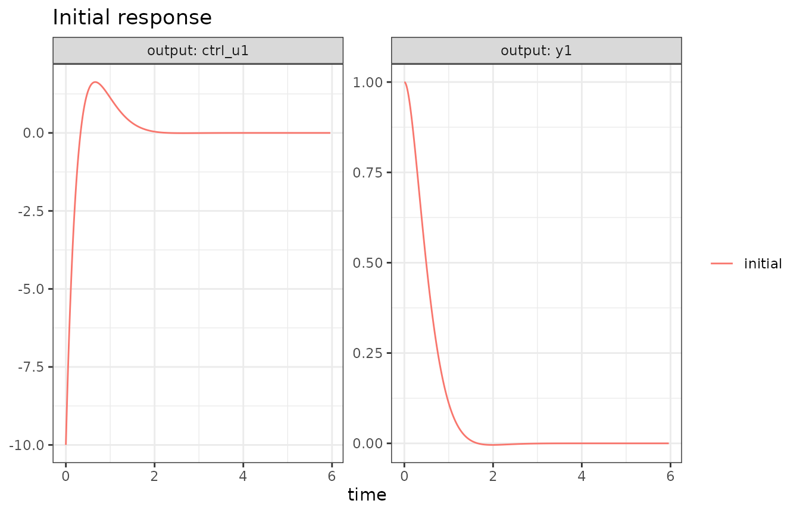
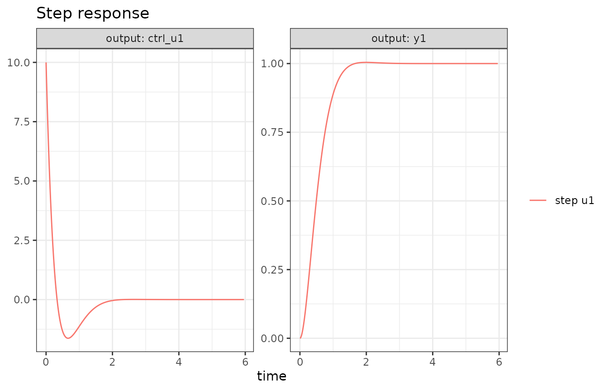

# State feedback: LQR and pole placement

``` r

library(controlcompR)
```

## The linear quadratic regulator

For \dot x = Ax + Bu, the law u = -Kx with K = R^{-1}(B^\top P +
N^\top), where P is the stabilizing solution of the continuous algebraic
Riccati equation, minimizes J = \int_0^\infty x^\top Q x + u^\top R u +
2 x^\top N u \\ dt . The conditions are checked: R \succ 0, the joint
weight \begin{pmatrix} Q & N \\ N^\top & R\end{pmatrix} \succeq 0, (A,
B) stabilizable, and no unobservable modes of the cost on the imaginary
axis. The minimum is over stabilizing inputs; it is the unrestricted
minimum when the cost detects every unstable mode. The optimality
statement holds only for this linear model and this cost; it says
nothing about constraints, model error or nonlinear plants.

``` r

plant <- ctrl_ss(matrix(c(0, 1, 0, 0), 2, byrow = TRUE), c(0, 1), c(1, 0),
                 state_names = c("position", "velocity"))
lqr <- ctrl_lqr(plant, Q = diag(c(1, 0.1)), R = 0.01)
lqr
#> LQR controller (continuous time), u = -K x
#> K =
#>    position velocity
#> u1       10    5.477
#> closed-loop poles: -2.739+1.581i, -2.739-1.581i
#> Riccati residual: 2.18e-15
```

The returned cost matrix gives the optimal cost from any initial state,
J^\star = x_0^\top P x_0:

``` r

x0 <- c(1, 0)
drop(t(x0) %*% lqr$P %*% x0)
#> [1] 0.5477226
```

### The weights trade speed against effort

``` r

designs <- lapply(c(1, 0.1, 0.01), function(r) ctrl_lqr(plant, diag(c(1, 0.1)), r))
sapply(designs, function(d) c(K = d$K, slowest_pole = max(Re(d$poles))))
#>                    [,1]      [,2]      [,3]
#> K1            1.0000000  3.162278 10.000000
#> K2            1.4491377  2.706392  5.477226
#> slowest_pole -0.7245688 -1.353196 -2.738613
```

### Closed-loop simulation

``` r

cl <- ctrl_closed_loop(plant, lqr)
plot(ctrl_initial(cl, x0 = c(1, 0)))
```



The closed loop has the plant outputs followed by the control signals,
so the actuator effort is always visible.

## Discrete and finite-horizon LQR

For discrete models
[`ctrl_lqr()`](https://adamrsophie.github.io/controlcompR/reference/ctrl_lqr.md)
solves the discrete Riccati equation.
[`ctrl_dlqr_finite()`](https://adamrsophie.github.io/controlcompR/reference/ctrl_dlqr_finite.md)
computes the time-varying gains of the finite-horizon problem by the
backward Riccati recursion; for long horizons the first gain converges
to the infinite-horizon gain:

``` r

pd <- ctrl_c2d(plant, 0.1)
inf <- ctrl_lqr(pd, diag(c(1, 0.1)), 0.01)
fin <- ctrl_dlqr_finite(pd, diag(c(1, 0.1)), 0.01, horizon = 200)
rbind(infinite = drop(inf$K), finite_first = drop(fin$K[[1]]))
#>              position velocity
#> infinite     7.612958 4.584935
#> finite_first 7.612958 4.584935
```

## Reference tracking

State feedback regulates to zero. To track a constant reference r, use u
= N r - K x with the static prefilter `N` that gives unit DC gain (it
exists when the plant has no zero at the origin):

``` r

N <- ctrl_reference_gain(plant, lqr)
N
#>      [,1]
#> v_u1   10
plot(ctrl_step(ctrl_series(ctrl_gain(N), cl)))
```



A prefilter is not robust to model error: a constant disturbance or a
gain mismatch leaves a steady-state offset. Integral action (augmenting
the state with the integral of the error) or offset-free MPC removes it.

``` r

# integral augmentation: z' = r - y
Aa <- rbind(cbind(plant$A, 0), cbind(-plant$C, 0))
Ba <- rbind(plant$B, 0)
aug <- ctrl_ss(Aa, Ba, diag(3))
Ki <- ctrl_lqr(aug, diag(c(1, 0.1, 5)), 0.01)$K
Ki
#>          x1       x2        x3
#> u1 20.47477 7.137895 -22.36068
```

## Pole placement

[`ctrl_place()`](https://adamrsophie.github.io/controlcompR/reference/ctrl_place.md)
computes `K` so that A - BK has prescribed eigenvalues, with the robust
eigenstructure assignment of Kautsky, Nichols and Van Dooren. For
several inputs the remaining freedom is used to make the closed-loop
eigenvectors as well conditioned as possible, and the condition number
is reported because it measures how fragile the placement is:

``` r

K <- ctrl_place(plant, poles = c(-2 + 1i, -2 - 1i))
K
#>      [,1] [,2]
#> [1,]    5    4
#> attr(,"poles")
#> [1] -2+1i -2-1i
#> attr(,"cond_X")
#> [1] 5.828427
#> attr(,"max_error")
#> [1] 7.108896e-16
eigen(plant$A - plant$B %*% K)$values
#> [1] -2+1i -2-1i
attr(K, "cond_X")
#> [1] 5.828427

A3 <- matrix(c(0, 1, 0, 0, 0, 1, 1, -2, -3), 3, byrow = TRUE)
B3 <- matrix(c(0, 1, 0, 0, 0, 1), 3)
K3 <- ctrl_place(A3, B3, c(-1, -2, -3))
attr(K3, "cond_X")
#> [1] 6.162278
```

Placing poles far to the left needs large gains, which amplify noise and
saturate actuators. LQR often gives better compromises because the
weights speak directly about states and inputs.
