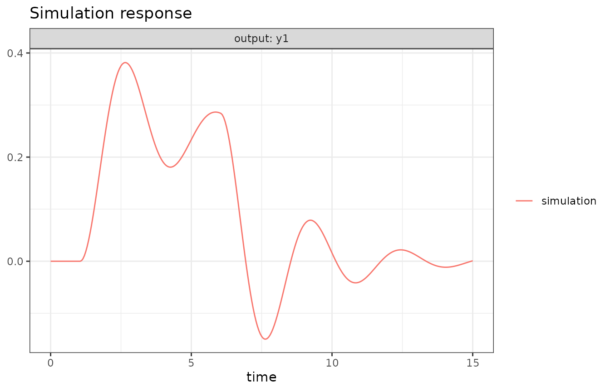
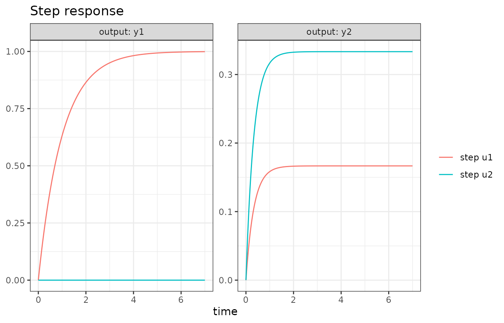
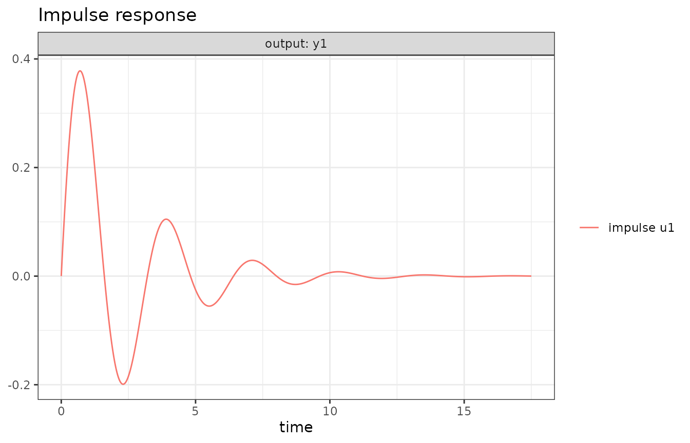
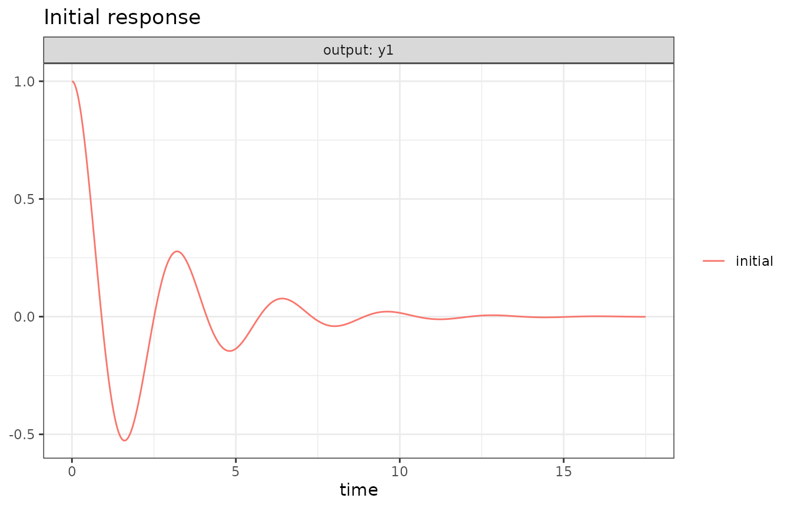

# Time responses

``` r

library(controlcompR)
```

## Simulation with arbitrary inputs

[`ctrl_simulate()`](https://adamrsophie.github.io/controlcompR/reference/ctrl_simulate.md)
integrates a continuous model exactly for inputs that are piecewise
constant (zero-order hold, the default) or piecewise linear (first-order
hold) between the time points, using matrix exponentials of augmented
matrices. No numerical ODE solver is involved, so the result is exact up
to rounding:

``` r

sys <- ctrl_ss(matrix(c(0, 1, -4, -0.8), 2, byrow = TRUE), c(0, 1), c(1, 0))
t <- seq(0, 15, by = 0.05)
u <- as.numeric(t > 1) - as.numeric(t > 6)
res <- ctrl_simulate(sys, input = u, times = t)
plot(res)
```



``` r

head(as.data.frame(res))
#>   time       case   kind signal value
#> 1 0.00 simulation output     y1     0
#> 2 0.05 simulation output     y1     0
#> 3 0.10 simulation output     y1     0
#> 4 0.15 simulation output     y1     0
#> 5 0.20 simulation output     y1     0
#> 6 0.25 simulation output     y1     0
```

For a discrete model the simulation is the difference equation itself
and `times` must be multiples of the sample interval.

## Step, impulse and initial-condition responses

When no time grid is given, one is chosen from the slowest and fastest
poles. Each input is applied in turn:

``` r

mimo <- ctrl_ss(diag(c(-1, -3)), matrix(c(1, 0.5, 0, 1), 2), diag(2))
plot(ctrl_step(mimo))
```



``` r

plot(ctrl_impulse(sys))
```



``` r

plot(ctrl_initial(sys, x0 = c(1, 0)))
```



## Step characteristics

``` r

G <- ctrl_tf(9, c(1, 1.2, 9))
info <- ctrl_step_info(G)
info
#>   output    case rise_time settling_time overshoot undershoot     peak
#> 1     y1 step u1 0.4012302      6.538462  52.65921          0 1.526592
#>   peak_time final_value settled
#> 1  1.072261           1    TRUE
```

The definitions are explicit: rise time from 10 to 90 percent of the
final change, settling time as the last exit from a 2 percent band,
overshoot and undershoot as percentages of the final change. For a
stable model the final value is taken from the DC gain; otherwise the
last simulated sample is used and `settled` says whether the response
had stopped changing. The classical approximation for the overshoot of a
second order system, 100 e^{-\pi \zeta / \sqrt{1 - \zeta^2}}, agrees:

``` r

zeta <- 1.2 / (2 * 3)
100 * exp(-pi * zeta / sqrt(1 - zeta^2))
#> [1] 52.66206
```

## Integral performance criteria

[`ctrl_performance()`](https://adamrsophie.github.io/controlcompR/reference/ctrl_performance.md)
computes IAE, ISE, ITAE, RMSE, control effort and the largest bound
violation for any recorded experiment:

``` r

st <- ctrl_step(G)
ctrl_performance(st$time, st$y[, 1, 1], r = 1)
#>       IAE       ISE     ITAE      RMSE
#> 1 1.11315 0.4833329 1.781247 0.2046612
```
